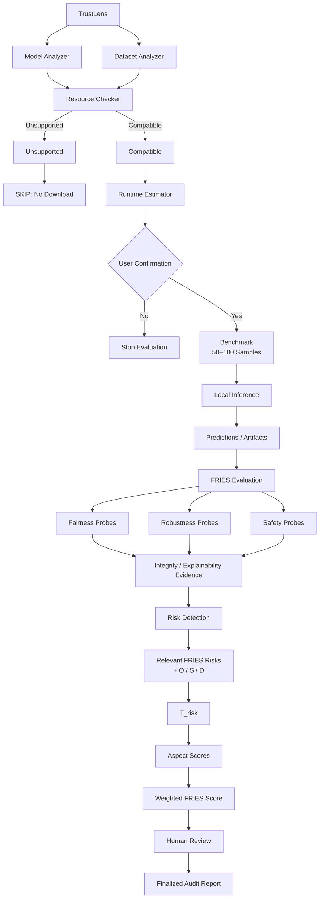

# TrustLens

Evidence-driven, risk-based auditing and benchmarking for machine-learning models.

TrustLens organizes evaluation around five FRIES dimensions — **Fairness, Robustness, Integrity, Explainability, and Safety** — and treats the overall FRIES number as a **traceable aggregation of risk assessments**, not as an objective or absolute measure of model safety or trustworthiness.

This README describes **what TrustLens is intended to become**, **what the repository currently implements**, and **what remains to be built**. Claims about current behavior are taken from the code. Claims about target methodology follow the TrustLens architecture specification.

## Vision

The intended system is a local-first platform that:

1. Imports a Hugging Face model and checks whether it can run on the available machine.
2. Collects **measured evidence** (metrics, hashes, documentation coverage, behavioral tests).
3. Maps that evidence onto **relevant FRIES risks**.
4. Proposes **Occurrence / Severity / Detection (O/S/D)** ratings.
5. Computes risk trust scores, aspect scores, and a weighted overall FRIES score.
6. Exposes every step for **human review and audit**.

The conceptual pipeline is:

```text
Measured evidence
       ↓
Relevant FRIES risk
       ↓
O / S / D assessment
       ↓
Risk trust score  T_risk = ∛(O × S × D)
       ↓
Aspect score
       ↓
Weighted FRIES score
```

TrustLens must never collapse a raw metric into a dimension score. Demographic parity difference is evidence of disparity, not the Fairness score. Documentation coverage is evidence of transparency, not the Explainability score. An unsafe-response rate is evidence for a safety risk, not the Safety score. An artifact hash is evidence of identity, not the Integrity score.

The FRIES score is a **systematic, interpretable, reproducible audit artifact**. It is not a scientific proof that a model is fair, robust, or safe.

## Methodology

### Three layers

| Layer | What it is | What it is not |
| ----- | ---------- | -------------- |
| **A. Measured evidence** | Probe outputs: DPD, EOD, F1 gap, clean vs perturbed accuracy, SHA-256, card coverage, entropy, and similar measurements | A FRIES dimension score |
| **B. Risk assessment** | Selecting relevant FRIES risks and assigning inverted O/S/D (heuristic unless empirically validated) | Automatic proof that a risk is present or absent |
| **C. FRIES score** | Geometric risk scores, aspect averages, weighted overall T | An objective ranking of models across unrelated tasks |

### O/S/D (FRIES convention)

FRIES adapts FMEA but **inverts** the usual meaning so that **higher values mean greater trustworthiness** (0–10):

- **O (Occurrence)** — higher means the risk is less likely.
- **S (Severity)** — higher means the potential impact is less severe.
- **D (Detection)** — higher means the risk is easier to detect.

A high ordinary FMEA score means high risk. A high FRIES O/S/D score means the opposite. Confusing the two is a correctness failure.

### Scoring (target and implemented math)

For each selected risk:

```text
T_risk = ∛(O × S × D)
```

Edge cases from the original FRIES algorithm, as implemented in `backend/app/scoring/fries.py`:

- Any of O, S, D equal to **0** (veto / deficit) → `T_risk = 0`.
- O = S = D = **10** (optimal) → `T_risk = 10`.

The aspect score is the mean of selected risk scores for that aspect. Overall FRIES is:

```text
FRIES = w_F T_F + w_R T_R + w_I T_I + w_E T_E + w_S T_S
```

Default weights are equal (`0.2` each). Custom weights must be documented in the report. The original methodology typically selects **1–3 relevant risks per aspect**.

Metric → O/S/D bands in this project are **heuristics**. They are labeled `PROPOSED / REQUIRES VALIDATION` and are not published scientific conversions.

### Evidence status (target)

Unavailable evidence must not become a fabricated numeric score. Intended statuses:

| Status | Meaning |
| ------ | ------- |
| `EVALUATED` | Required evidence was measured; O/S/D may exist |
| `INSUFFICIENT_EVIDENCE` | Required inputs were missing — do not invent O/S/D |
| `NOT_APPLICABLE` | Risk is not meaningful for this model/task |
| `SKIPPED` | Intentionally not run |
| `FAILED` | Attempted and failed technically |
| `PROXY` | A substitute model or dataset was used — must be labeled, never silent |

When an entire aspect cannot be evaluated, the overall FRIES score should be marked **partial** (reweight evaluated aspects) or **withheld**. Do not fill the gap with 0 or 1.

## Current implementation

TrustLens today is a **working v1 product** over **Layer A probe evidence**: FastAPI + Celery + React, Hugging Face **metadata** import, five FRIES probes, a default **deterministic** O/S/D mapper that **abstains**, original FRIES math when complete O/S/D exist, dual **workflow** modes, human review, versioned JSON/PDF reports, an opt-in publish flag, and append-only filesystem evidence. It is a single-user local application: no login or roles (removed in Alembic `008`).

Default evaluations **do not invent O/S/D**. FRIES is **withheld** (status still `FINALIZED`; no `final_scores` row). That is not a low trust score.

### What works

- **Model registry** — `POST /v1/models/import-hf` resolves Hub **metadata only** (card, tags, license, file list). It does **not** download weights.
- **Async evaluations** — `POST /v1/evaluations` enqueues `trustlens.evaluate_model`; probes run F → R → I → E → S.
- **Probes emit metrics and evidence**, not FRIES scores. Each probe result carries a first-class `ProbeEvaluationStatus` (`EVALUATED` / `INSUFFICIENT_EVIDENCE` / `NOT_APPLICABLE` / `SKIPPED` / `FAILED` / `PROXY`). Confidence is an **uncalibrated evidence-strength** geometric mean (`data_quality`, `probe_reliability`, `evidence_completeness`) — not correctness and not O/S/D. Under methodology versions from `v2-per-dimension-2026` on (current: `v9-evidence-guards-2026`), dimensions marked `NOT_APPLICABLE` are excluded from the overall confidence figure (still shown as `None` per-dimension); legacy evaluations keep the old fold-in-at-value behavior byte-for-byte.
- **Every evaluation is stamped with an immutable `methodology_version`** at creation (`backend/app/scoring/methodology_version.py`), copied verbatim into its report. Historical evaluations predating this field carry a `LEGACY_METHODOLOGY_VERSION` sentinel.
- **Assessment engine (orthogonal to workflow mode)**
  - **Default `deterministic`** — O/S/D are not generated (no validated mapping). FRIES withheld.
  - **`legacy_heuristic`** — explicit opt-in, **top-level** `probe_config.assessment_engine` only. `extra.assessment_engine` (including `"heuristic"`) is ignored. `HeuristicOSDAgent` (not an LLM) uses the calibrated `osd-map-v4` mapping plus v9 evidence guards: Integrity artifact `MISMATCH` floors O=S=1, Safety abstains when `benign_fpr > 0.30`, and D falls with CI width. These thresholds are `PROPOSED`, fitted to injected defects — range normalisation, not calibration.
  - **`llm_v1`** — `HybridOSDAgent` (`backend/app/osd/hybrid.py`): heuristic baseline for all five dimensions, then one batched LLM call (Gemini → Groq → NVIDIA NIM) re-scores Integrity/Explainability/Safety; any failure falls back to the heuristic, tagged `heuristic_fallback`. Fairness and Robustness are never LLM-scored. Not validated as ground truth; see `results/l2_det_vs_llm_20261003*/FINDINGS.md`.
- **Workflow modes** (`AI_AUTONOMOUS` / `AI_ASSISTED`) are **human-review gates**, not LLM interpretation. Enum names are historical.
  - `AI_AUTONOMOUS` — pipeline may finalize without a reviewer (`human_reviewed=false`).
  - `AI_ASSISTED` — stops at `AWAITING_REVIEW`; a reviewer records or edits O/S/D, then finalize.
- **Original FRIES scorer** — cube-root risk scores, veto, aspect mean, weighted total; frozen vectors in `shared/scoring/fixtures/fries_test_vectors.json`. Runs only when complete numeric O/S/D exist (legacy engine or human-supplied complete triples).
- **Reports** — canonical `report_v1` JSON in artifact storage when FRIES was scored; PDF is a projection. Append-only versions. Finalized + withheld FRIES returns 409 (not “not finalized yet”).
- **Publish flag** — private by default; publish only after FINALIZED **and** a FRIES score exists. There is no ranking or leaderboard; scores are not a universal trust measure.
- **Evidence store** — SHA-256 artifacts on the local filesystem (`STORAGE_DIR`), evaluation-scoped.

### Open methodology questions (recorded, not solved in this freeze)

- Amendment **A6** vs default withhold: whether/when a partial FRIES should exist without a validated O mapping.
- Confidence factor weights remain **uncalibrated** (`proposed_calibration`).
- `llm_v1` O/S/D is an experimental comparison engine, not a validated rater (see L2/L10 findings under `results/`).

### How probes actually run

| Dimension | Current evidence | Runs the imported model? |
| --------- | ---------------- | ------------------------ |
| **Fairness** | User-supplied local dataset with column-role mapping. Binary: equal-opportunity gap (max−min group TPR) with bootstrap CI, risk `F-FAIR-EOPP` (`tl-fairness-binary-v1.2`); multiclass: `F-FAIR-PERF` worst-group accuracy gap. Wide CI blocks scoring; single-class prediction collapse is gated | **Yes** — local Transformers backend (`LocalHFBackend`) predicts on the dataset |
| **Robustness** | Clean vs character-swap accuracy; `D` uses the clean-accuracy CI | **Yes**, for text-classification models (CPU/CUDA, device recorded). Other modalities skip the attack |
| **Integrity** | Hub identity/disclosure evidence (`I-INT-*`) plus **artifact-set hash verification**: all weight shards + loader files vs Hub LFS sha256 or a local manifest → `VERIFIED` / `MISMATCH` / `INCOMPLETE` / `UNPINNED` / `UNSUPPORTED`. Only `MISMATCH` is a risk (`I-INT-BYTES-DIVERGE`). No `integrity_score_0_10` | Hashes cached/local weight bytes; cannot catch a forger who controls the Hub repo (ADR 0013) |
| **Explainability** | Model-card ATX section coverage (intended use, limitations, training data, evaluation, ethical considerations); gaps reported as `disclosure_gaps` | Metadata only; not SHAP/LIME |
| **Safety** | Governance disclosure checklist **plus behavioural probe**: severe-harm false-negative rate (Wilson CI), harmful recall, benign FPR on labelled data with a `severe` marker | Yes, for the behavioural part when such data is supplied |

### Known methodological gaps (present in code)

These are the main deviations from the target architecture:

1. **One O/S/D triple per dimension**, not a catalog of 1–3 selected FRIES risks with structured mapping traces (`rule_id`, band, rationale, methodology version).
2. **Explainability and Safety still fall back to a fixed empty-card band `(2, 2, 3)`** when there is no card evidence, instead of abstaining. Fairness, Robustness, and Integrity now abstain (`None`) on missing evidence rather than inventing a number.
3. **Fairness depends on user-supplied labelled data with group columns.** Without it the probe cannot score; the old Adult-Census logistic-regression proxy is no longer the default path.
4. **Coverage ratios and integrity pass rates are still easy to confuse with aspect scores.** The scorer uses O/S/D, but the agent bands those O/S/D values directly from coverage / pass rate / disparity — closer to “metric → dimension rating” than “evidence → named risk → O/S/D”.
5. **Overall FRIES always assumes five aspects.** Missing dimensions are not withheld or reweighted; empty risk lists currently score as `0`. (The separate confidence-engine `overall` figure already excludes `NOT_APPLICABLE` dimensions under `methodology_version="v2-per-dimension-2026"` — this gap is about the FRIES score itself, not confidence.)
6. **No resource checker, compatibility states, or benchmark-first runtime estimate** before download. HF import never downloads weights; probes may download a sequence-classification model at run time with no VRAM/RAM/disk gate.
7. **Inference backend is local Transformers only** (sequence classification/regression via `LocalHFBackend`); no hosted or other-task backends.
8. **Integrity** records named risks (`I-INT-*`) and verifies artifact-set hashes; it does not claim tampering, true lineage, or a generic integrity score.
9. **Safety behavioural evidence is only as good as the user-supplied labelled data** (no built-in unsafe-prompt suite); governance coverage is the fallback.
10. **Reports are still score-centric** relative to the target (limited hardware, mapping-trace, and limitation sections).

Experiment outputs under `results/` are frozen per methodology version (v8 folders untouched by the v9 reruns). Round-3 validation studies (L1 calibration, L2 deterministic-vs-LLM, L4–L7 fairness/severity/integrity, L10 evidence review) each carry a `FINDINGS.md`. Do not silently rewrite them.

## Target architecture

Local Hugging Face execution is the intended default. Hosted inference is not required for the core system. Compatibility must treat **disk, RAM, and VRAM as separate constraints** (reference machine in the spec: RTX 4060 Laptop, 8 GB VRAM, 16 GB RAM). Parameter-count heuristics are estimates with safety margin, not hard guarantees.

## Roadmap

Work is ordered to match the specification’s implementation phases. Items already in the repo are marked.

| Phase | Intent | Status |
| ----- | ------ | ------ |
| 1 | Probe evaluation statuses, nullable O/S/D, status-aware runner | **Partial** (`ProbeEvaluationStatus` + methodology-version-gated confidence exclusion exist; Explainability/Safety still band a fixed empty-card default instead of abstaining) |
| 2 | Model analyzer + disk/RAM/VRAM compatibility (`SUPPORTED` / `CONSTRAINED` / `UNSUPPORTED` / `UNKNOWN`) | **Absent** |
| 3 | `InferenceBackend` / `LocalInferenceBackend`; evaluation separated from execution | **Mostly done** (`LocalHFBackend` used by fairness/robustness/safety) |
| 4 | Short benchmark, throughput, runtime estimate, optional cache | **Absent** |
| 5 | Fairness on the **imported** model; explicit legacy proxy mode | **Done** for user datasets (EOPP / multiclass gap); no explicit proxy mode |
| 6 | Robustness on the imported model; skipped/N/A must not invent O/S/D | **Partial** (NLP char-swap exists; skip still bands O/S/D) |
| 7 | Integrity as FRIES risk taxonomy + provenance/hash/uncertainty evidence | **Mostly done** (artifact-set hash verification, `I-INT-*` risks) |
| 8 | Explainability as documentation/transparency **risks**, not coverage-as-score | **Partial** (card coverage) |
| 9 | Safety behavioral + governance evidence → risks | **Partial** (behavioural severe-FNR probe + governance checklist) |
| 10 | Explicit mapping rules, traces, methodology version | **Partial** (free-text rationales; no structured trace) |
| 11 | Multi-risk aspect aggregation; partial FRIES / withhold policy | **Partial** (math exists; always five aspects; empty → 0) |
| 12 | Reports/UI: evidence, statuses, limitations, calculation breakdown | **Partial** (reports + UI exist; not limitation-complete) |
| 13 | Regression suite covering statuses, proxy, mapping, partial FRIES | **Partial** (strong probe/API/lifecycle tests; status enum untested because absent) |

Also remaining (product, not FRIES math): attack-simulation phases, cryptographic report signing, SHAP/LIME as optional explainability extensions, calibrated O/S/D science, OAuth/SSO.

**Non-goals:** do not add an ML model that predicts trustworthiness or classifies risk. Do not treat proxy evaluation as direct evaluation. Do not present heuristic thresholds as empirically validated.

## Repository layout

```text
backend/   FastAPI /v1, probes, O/S/D agent, FRIES scorer, reports
worker/    Celery consumer (same probe pipeline)
frontend/  Vite + React dashboard
configs/   Pinned datasets_v1.yaml + experiments_v1.yaml
docs/      Experiment runbook and results write-up
results/   Frozen experiment CSVs (do not silently rewrite)
shared/    Frozen FRIES scoring fixtures
```

API detail and probe formulas: [backend/README.md](backend/README.md).  
Worker: [worker/README.md](worker/README.md).  
UI routes: [frontend/README.md](frontend/README.md).  
Test matrix: [backend/tests/README.md](backend/tests/README.md).  
Scoring oracle: [backend/tests/SCORING.md](backend/tests/SCORING.md).

## Quick start

**Prerequisites:** Docker Desktop (Compose v2). Python 3.11+ and Node 18+ for native/hybrid runs. Optional: Make.

**Native (non-Docker) setup:** `scripts/setup-local-dev.ps1` creates the venv and installs dependencies; `scripts/dev-backend.ps1`, `dev-worker.ps1` and `dev-frontend.ps1` start each service.

```powershell
cp .env.example .env
docker compose up --build -d
docker compose exec api alembic upgrade head
```

| Service | Port |
| ------- | ---- |
| API | 8000 |
| Frontend | 5173 |
| Postgres | 5432 |
| Redis | 6379 |

**GPU:** `docker compose up --build -d` requests NVIDIA GPU passthrough for the `worker` service by default (Compose Spec device reservation). On a host with an NVIDIA GPU:
- Linux: install the [NVIDIA Container Toolkit](https://docs.nvidia.com/datacenter/cloud-native/container-toolkit/latest/install-guide.html) and restart Docker.
- Windows: use Docker Desktop with the WSL2 backend and a standard NVIDIA driver (no extra toolkit needed).

Verify first with `nvidia-smi` (host) then `docker run --rm --gpus all nvidia/cuda:12.4.0-base-ubuntu22.04 nvidia-smi` (Docker GPU access). If you don't have an NVIDIA GPU/toolkit at all, the default `deploy` reservation makes `docker compose up` fail outright — use the CPU-only override instead:

```powershell
docker compose -f docker-compose.yml -f docker-compose.cpu-only.yml up --build -d
```

Either way, CPU vs CUDA selection *inside* the worker is always detected at runtime (`backend/app/inference/device.py`) — the Compose files only control whether Docker exposes the GPU device at all. Each evaluation's actual execution device (and a real GPU name, or an explicit fallback reason) is persisted on `evaluations.execution_metadata` and shown on the evaluation detail page — never assumed from configuration alone.

Open `http://localhost:5173` (no login).

Typical demo: import a small text-classification Hub id (for example `distilbert-base-uncased-finetuned-sst-2-english` or `prajjwal1/bert-tiny`) → create an **auto-finalize** evaluation (default deterministic engine) → wait for `FINALIZED` → inspect probe evidence. O/S/D show **Unavailable** and **FRIES is withheld**. Set top-level `probe_config.assessment_engine` to `legacy_heuristic` or `llm_v1` to score a FRIES path. For **human review before finalize**, record O/S/D on the review page, then finalize.

Gated Hub repos need `HF_TOKEN` in `.env`. The API has no authentication; Compose publishes its ports on all interfaces, so on a shared network bind them to `127.0.0.1`.

OpenAPI: `http://localhost:8000/docs`. Health: `GET /health`.

```powershell
make test-backend   # same as CI: -m "not integration", needs Postgres
make test-unit      # skips lifecycle/slow; OK without Postgres
```

CI (`.github/workflows/ci.yml`) runs ruff + pytest (Postgres service) and the frontend `tsc` + Vite build.

## Using the product honestly

- Default O/S/D are **not generated**. Legacy heuristic values (opt-in engine) are **proposed**, not ground truth, and not an LLM.
- Confidence is **uncalibrated evidence strength**, not model quality. The FRIES hero does not show OSD-mean “confidence”.
- Fairness numbers describe the imported model's behaviour on **your** dataset's groups, with bootstrap CIs; wide CIs block scoring.
- Robustness numbers describe **character-swap** degradation on supported text classifiers only.
- `llm_v1` and `legacy_heuristic` O/S/D are proposals for comparison and review, not validated ratings.
- Integrity uses Layer A Hub identity/disclosure evidence. Named risks use `aspect_scoring=risk_detected` — **not** an Integrity FRIES score.
- Scores are comparable only with a shared task, dataset, configuration and model revision; TrustLens does not rank models.

## License and research

Experiment protocol and limitations: [docs/experiments_runbook.md](docs/experiments_runbook.md).  
ADR: [docs/adr/0013-artifact-set-integrity.md](docs/adr/0013-artifact-set-integrity.md).  
Analysis: [docs/results_chapter.md](docs/results_chapter.md), [docs/RESULTS_SUMMARY.md](docs/RESULTS_SUMMARY.md).
