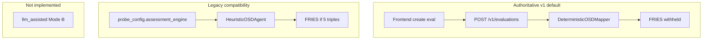
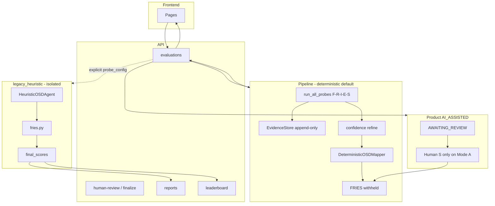

# TrustLens Phase 6 — Full-System + Frontend Audit and Implementation Plan

**Status:** audit and implementation plan only. Not a code change. Not a methodology rewrite. Not a self-sign-off of implementation.  
**Date:** 2026-09-07  
**Follow-up:** supplemental findings from the dedicated frontend and backend read-only audits were merged in (Integrity `aspect_scoring` token, Fairness/Robustness persist gaps, review `|| 0`, report executive-summary UI bug, `extra.heuristic` alias).  
**Does not modify:** Fairness, Robustness, Integrity, Explainability, or Safety probe science; `fries.py`; `HeuristicOSDAgent`.  
**Audience:** review this document before any Phase 6 implementation.

---

# 1. Executive summary

Phases 1–5 produced a **backend Layer-A system that is largely scientifically honest**. The five probes emit evidence, status, named detections, claim boundaries, and (for Fairness/Robustness) uncertainty. The default assessment engine is `deterministic`: **O = null, S = null unless a human later supplies S, D = unavailable, FRIES withheld**. That matches the locked architecture in [`TRUSTLENS_FIVE_PROBE_METHODOLOGY_AUDIT.md`](TRUSTLENS_FIVE_PROBE_METHODOLOGY_AUDIT.md) and the Phase 1–5 implementation plans.

The product that users actually see is **not yet a coherent TrustLens v1**.

The default UI path is: import HF model → create **AI-Autonomous** evaluation → pipeline runs five probes → `DeterministicOSDMapper` abstains → evaluation becomes **FINALIZED without a FRIES number**. The evaluation detail page then shows:

- labels that imply an **AI agent proposed O/S/D**
- a disclaimer that **O/S/D were generated automatically** (false on this path)
- **no probe evidence**, no `methodology_version`, no `claim_boundary`, no per-probe `EVALUATED` / `INSUFFICIENT_EVIDENCE` / `FAILED`
- a numeric **evidence confidence** (0–1) with no dimension cards
- **no FRIES-withheld explanation** (the FRIES card is simply absent)
- **no report**, because reports require a `final_scores` row

So the backend mostly preserves evidence; the **API and frontend drop it** and replace it with Phase 16–22 scoring-product language.

**Finding counts (after supplemental merge):** 3 P0, 12 P1, 15 P2; remainder P3 / DEFERRED / LEGACY / VALID in §21.

**Answers to the twelve audit questions**

| # | Question | Answer |
| - | -------- | ------ |
| 1 | Five probes scientifically honest? | **Mostly yes** at Layer A. F/R measure rates with gates/CIs. I/E/S measure documentation/identity disclosure. Local probe confidence is overwritten by the engine (intended). |
| 2 | Pipeline preserve evidence without reinterpretation? | **Yes on the default OSD path** (copy metadata, do not recompute). **No on `legacy_heuristic`**. Runner **does** overwrite probe-local confidence with engine factors. |
| 3 | Confidence mean what the project says? | **In the engine, yes** (evidence strength, `proposed_calibration: true`). **In the UI, weakly** (bare 0.xx next to FRIES; OSD uses a different aggregate). |
| 4 | Downstream unsupported scores? | **Default path: no FRIES number.** `legacy_heuristic` and any complete O/S/D document **do** produce FRIES. Reports and leaderboard only exist on that complete path. |
| 5 | O/S/D or FRIES fabricated indirectly? | **Not on default Mode A.** Fabrication remains on **explicit `legacy_heuristic`**. Disclaimers and reports can **verbally fabricate** (“AI generated O/S/D”) even when values are null. |
| 6 | Mode A / Mode B boundary enforced? | **Mode A (deterministic OSD) is enforced.** **Mode B (`llm_assisted`) does not exist.** Product enums `AI_AUTONOMOUS` / `AI_ASSISTED` are a **human-finalize workflow**, not LLM interpretation. |
| 7 | API preserve evidence and claim boundaries? | **Persisted, not served.** `GET /v1/evaluations/{id}` has no probe payloads. Claim boundaries live in `probe_results.metric_values` and MinIO artifacts only. |
| 8 | Frontend display evidence honestly? | **No — it barely displays evidence.** Review page is the most honest surface; evaluation/report/leaderboard are score-shaped. |
| 9 | Accidental implications (coverage=quality, etc.)? | **Yes in copy and layout**, especially Mode labels, “Agent O/S/D”, FRIES hero, leaderboard ranking, report “dimension Score” table. Backend I/E/S notes are correct but **invisible in the UI**. |
| 10 | Historical paths isolated? | **Isolated from the default UI** (frontend never sends `assessment_engine`). **Not isolated from the API** (`probe_config.assessment_engine=legacy_heuristic` is a valid authenticated create). |
| 11 | Ready to call coherent TrustLens v1? | **No.** Backend Layer A is close; the **served product** still describes a scoring agent. |
| 12 | What must be fixed before v1 freeze? | Honest Mode/OSD/FRIES language; expose probe evidence on the default FINALIZED path; evidence-only reporting; unavailable (not blank) O/S/D; do not rank models as if default runs had FRIES. |

**Phase 6 should not** rewrite probes, invent a TrustLens composite, add behavioral Safety, or implement LLM-assisted Mode B — unless a later methodology decision says so. Phase 6 **should** make the **existing** Layer A visible and stop describing it as an AI scoring system.

---

# 2. Repository architecture

Discovered structure (do not assume names from the blueprint):

| Layer | Location | Role |
| ----- | -------- | ---- |
| Frontend | `frontend/` — Vite + React 19 + React Router 7 | SPA. Entry `src/main.tsx`, routes `src/App.tsx`. No tests, no e2e. |
| API | `backend/app/main.py` FastAPI `0.20.1` | `/health`, `/v1/*` |
| Auth | JWT + roles `researcher` / `reviewer` / `admin` | Tokens in `localStorage` |
| Worker | `worker/` Celery | Wraps `run_evaluation_pipeline` |
| Probes | `backend/app/probes/` | F→R→I→E→S via `registry.py` + `runner.py` |
| Inference | `backend/app/inference/` | Local HF + pairing adapters (Fairness/Robustness) |
| Datasets | `configs/datasets_v1.yaml`, `supported_pairings_v1.yaml`, `supported_robustness_compat_v1.yaml` | Explicit pairings |
| Confidence | `backend/app/confidence/engine.py` | Factor model, geometric mean |
| O/S/D | `deterministic.py` (default), `agent.py` (legacy), `review.py` (human) | Representation / heuristic / merge |
| FRIES | `backend/app/scoring/fries.py` | Frozen math; **only** from finalized complete triples |
| Persistence | Postgres via SQLAlchemy `app/db/models.py` | evaluations, probe_results, osd_agent_outputs, human_reviews, final_scores, reports |
| Evidence | MinIO/S3 `app/storage/evidence_store.py` | Append-only JSON artifacts |
| Reports | `app/reports/builder.py` + `templates/report_v1.html` | Requires `final_scores` |
| Tests | `backend/tests/` (~70 files) | Strong backend; **zero** frontend tests |
| Methodology | `docs/TRUSTLENS_*.md` | F/R spec + five-probe audit + Phase 3–5 plans |
| Blueprint | `docs/TRUSTLENS_IMPLEMENTATION_BLUEPRINT.md` | **Non-authoritative** |

**Frontend routes**

| Path | Page |
| ---- | ---- |
| `/login` | `LoginPage.tsx` |
| `/` | `DashboardPage.tsx` |
| `/models`, `/models/import`, `/models/:id` | list / HF import / launch evaluation |
| `/evaluations/:id` | `EvaluationDetailPage.tsx` (poll 2.5s while active) |
| `/evaluations/:id/review` | `ReviewPage.tsx` |
| `/reports/:evaluationId` | `ReportPage.tsx` |
| `/leaderboard` | `LeaderboardPage.tsx` |

**API surface (v1)**

- `POST/GET /v1/evaluations`, `GET /v1/evaluations/{id}`
- `POST .../human-review`, `.../finalize`, `.../publish`, `.../unpublish`
- `POST /v1/models/import-hf`, model CRUD
- `GET/POST /v1/reports/{id}`
- `GET /v1/leaderboard`
- **No** `GET .../probes` or nested probe results on evaluation reads

**Product modes vs methodology modes (collision)**

```text
methodology Mode A     = assessment_engine=deterministic     (implemented, default)
methodology Mode B     = assessment_engine=llm_assisted      (NOT implemented)
legacy                 = assessment_engine=legacy_heuristic  (API-opt-in)

product evaluation_mode:
  AI_AUTONOMOUS = pipeline may write FRIES if O/S/D complete; no human review
  AI_ASSISTED   = stop at AWAITING_REVIEW; human accept/edit then finalize
```

These two axes are orthogonal. The UI treats them as one “AI” story. That is the largest product-architecture inconsistency.

---

# 3. Five-probe cross-dimension audit

Authority: implemented probes + Phase 1–5 plans + five-probe methodology audit. Blueprint ignored.

## 3.1 Per-dimension facts (as implemented)

| | Fairness | Robustness | Integrity | Explainability | Safety |
| - | -------- | ---------- | --------- | -------------- | ------ |
| **methodology_version** | `tl-methodology-v1.0` | `tl-methodology-v1.0` | `tl-integrity-v1.0` | `tl-explainability-v1.0` | `tl-safety-v1.0` |
| **basis** | F/R spec + amendments | same | five-probe audit | five-probe audit | five-probe audit |
| **objective** | Group disparity on declared pairing (or Adult proxy) | Paired clean vs char-swap accuracy on explicit dataset | Hub identity / provenance / disclosure; conditional hash compare | Card documentation completeness + light contradiction flags | Card safety-governance disclosure + lexical phrase flags |
| **measured evidence** | DP/EO (binary evidence), worst-group acc gap (multiclass scored family), CIs, n | clean/robust acc, drop, paired bootstrap, perturbation coverage | identity, files listing, license, card, optional hash comparison | required section presence, `coverage_ratio`, contradictions | 4 required sections, `coverage_ratio`, `high_impact_claims` as **metadata flags** |
| **status model** | EVALUATED (incl. no_material_risk, mapping_blocked), INSUFFICIENT_EVIDENCE, NOT_APPLICABLE, FAILED, PROXY | EVALUATED / INSUFFICIENT_EVIDENCE / FAILED (+ gates) | EVALUATED / INSUFFICIENT_EVIDENCE / FAILED | same family as Integrity | same family as Explainability |
| **gates** | G-FAIR-N-TOTAL, N-GROUP, CI-WIDE, pairing | G-ROB-N-EVAL, LABEL-COMPAT, CLEAN-FLOOR, CI-WIDE, DOMAIN, coverage | G-INT-IDENTITY-EMPTY; hash unverified is **claim-scope**, not whole-probe fail | G-EXP-CARD-EMPTY | G-SAFE-CARD-EMPTY |
| **named detections** | `F-FAIR-PERF` (scored family, O still null) | `R-ROB-PERT` (same) | `I-INT-REV-UNPINNED`, `MANIFEST-MISSING`, `LICENSE-UNDISCLOSED`, `BYTES-DIVERGE` | `E-DOC-INCOMPLETE`, `E-DOC-CONTRADICTION` | `S-GOV-DISCLOSURE-GAP` |
| **scored_risk_id** | may be `F-FAIR-PERF` | may be `R-ROB-PERT` | **always null** | **always null** | **always null** |
| **aspect_scoring** | `scored_risk` / `no_material_risk` / `mapping_blocked` / not scored | same | **`scored_risk` if any named risk** (despite `scored_risk_id=None`) | `risk_detected` / `no_material_risk` / `not_scored` | same as Explainability |
| **confidence factors** | n/skip/CI/evidence | n, CI, reliability, evidence | identity richness; **not** a 0–10 score | **not** a function of `coverage_ratio` | **not** coverage or high-impact phrases |
| **deterministic O/S/D** | copy metadata; O/S/D null | same | same | same | same |
| **FRIES (default)** | withheld | withheld | withheld | withheld | withheld |
| **claim boundary** | present in metrics/artifact | present | present | present | present |
| **limitations** | present | present | present | present | present |
| **historical compat** | `legacy_heuristic` maps gaps → O=S, D≈8 | maps clean/robust/degradation | maps check pass_rate, D=8 | maps coverage; empty → `(2,2,3)` | maps coverage; high-impact lowers S/D; empty → `(2,2,3)` |

`integrity_score_0_10` is **absent** from current Integrity metrics (runner tests assert this). That Phase 3 removal is **VALID**.

## 3.2 Matrix: agree / intentionally differ / accidentally differ

**Agree (should stay aligned)**

- Evidence first; no probe writes FRIES or O/S/D.
- `proposed_mapping: false`, `osd_proposals: []` on I/E/S (and F/R v1 mapping not activated).
- Deterministic mapper copies; does not recompute.
- D unavailable; no AI D.
- Missing evidence → `INSUFFICIENT_EVIDENCE`, not a fake low band (except **legacy** empty-card `(2,2,3)`).
- Confidence engine overwrites local heuristics at persist time.

**Intentionally differ (do not force symmetry)**

- F/R: statistical measurement + CIs + `tl-methodology-v1.0`.
- I/E/S: metadata/documentation + dimension-specific versions.
- F/R may set `scored_risk_id` as a **named Layer-A scored-family id**. Explainability/Safety keep `scored_risk_id=null` and use `aspect_scoring=risk_detected`. **Integrity disagrees:** it emits `aspect_scoring=scored_risk` with `scored_risk_id=None` (`integrity_eval.py` ~370–379). Phase 3 intended the E/S `risk_detected` token. This is an **implementation/methodology conflict**, not FRIES (O still null).
- F/R `aspect_scoring=scored_risk` does **not** mean FRIES was computed (O still null). The word “scored” is **overloaded** and is now **worse on Integrity**.

**Accidentally differ (Phase 6 cleanup, not science)**

| Issue | Evidence |
| ----- | -------- |
| I/E/S `flags` live on `ProbeOutput` and in the **artifact**, but **not** in persisted `metric_values`; F/R put `flags` in metrics. Report builder reads `metric_values.flags`. | `integrity.py` metrics vs artifact; `builder.py` `metric_values.get("flags")` |
| Fairness **binary pairing** and **Adult proxy** persist via `_finish` without `methodology_version`, `aspect_scoring`, `scored_risk_id`, or `claim_boundary`. Multiclass uses `_finish_methodology`. | `fairness.py` `_finish` ~779–843 vs `_finish_methodology` |
| Robustness artifact stamps `"methodology"` but persisted metrics have **no** `methodology_version` key | `robustness.py` artifact ~449; grep of persist dict |
| Confidence `summarize` geometric mean vs OSD `overall_confidence` **arithmetic mean** | `engine.py` `summarize`; `deterministic.py` line ~187 |
| Engine module docstring still says E/S `data_quality` uses `coverage_ratio` | `engine.py` lines 5–6 vs `_explainability_factors` / `_safety_factors` |
| Frontend never shows any of the above | `EvaluationRead` has no probes |

---

# 4. End-to-end pipeline audit

Traced path (default UI):

```text
ModelDetailPage POST /v1/evaluations
  { model_id, evaluation_mode: AI_AUTONOMOUS }   // no probe_config
    → EvaluationService.create_evaluation
      parse_probe_config → assessment_engine defaulted to "deterministic"
      enqueue Celery
    → run_evaluation_pipeline
      PENDING → RUNNING
      run_all_probes (F→R→I→E→S)
        probe.run → evidence_store.put_artifact
        refine() overwrites confidence
        persist probe_results
      PROBES_COMPLETED
      DeterministicOSDMapper.propose (O/S/D all None)
      persist osd_agent_outputs.ai_suggestion
      AGENT_COMPLETED
      AI_AUTONOMOUS: to_finalized_osd → complete_aspect_count=0
        → FINALIZED, no final_scores row
    → GET /v1/evaluations/{id} build_detail
      probe_progress, confidence_summary, osd_agent, final_score=null,
      mode_disclosure (AUTONOMOUS_DISCLAIMER)
      // probes omitted
    → EvaluationDetailPage
```

## 4.1 Transition checks

| Hop | Shape | Overwrite / default | Claim / status / methodology |
| --- | ----- | ------------------- | ---------------------------- |
| Create | `probe_config` dict | Default `assessment_engine=deterministic` | Frontend cannot select engine |
| Probes | `ProbeOutput` + artifact JSON | Confidence **overwritten** by `refine` | `probe_status` copied into metrics |
| Persist | `probe_results` | Flags for I/E/S **dropped** from metrics | methodology_version **kept** in metrics |
| OSD | `ai_suggestion` | Mapper copies allowlisted keys only | `mapping_reason=no_approved_mapping` |
| Missing probe snapshot | Aspect with conf **0.2** | Default, not a measurement | status INSUFFICIENT_EVIDENCE |
| Missing snap.confidence | **0.5 default** | Fabricated strength if a row lacked confidence | Unlikely after runner |
| Missing probe_status | Mapper **EVALUATED** | Dangerous default if status omitted | Runner always writes `probe_status` |
| Autonomous FRIES | `score_from_finalized_osd` | Only if 5 complete triples | Withheld otherwise — **VALID** |
| Assisted | AWAITING_REVIEW | No FRIES until human finalize | Review merge cannot set O/D if deterministic |
| API detail | `EvaluationRead` | **Drops probe metrics** | claim_boundary lost at the wire |
| Frontend | React state | Polling stops on FINALIZED/FAILED/AWAITING_REVIEW | Blank O/S/D cells |

**Places values are recomputed:** confidence `summarize` on GET (uses stored confidence if present — OK). FRIES only from finalized OSD (does not re-read probes). Heuristic agent **reinterprets** metrics into bands (legacy only).

**Null → number:** not on default FRIES (no row). OSD confidence 0.5/0.2 defaults. Frontend `{aspect.O}` when `null` renders **empty**, not `0` (does not fabricate zero; still unreadable).

---

# 5. Confidence audit

## 5.1 Factor functions and callers

| Function | Used for | Coverage-based? |
| -------- | -------- | --------------- |
| `_fairness_factors` | Fairness | No (computed metrics, n, gates, evidence) |
| `_robustness_factors` | Robustness | No (n, CI, reliability, evidence) |
| `_integrity_factors` | Integrity | No (status, identity snapshot, checks, hash-unverified 0.85) |
| `_explainability_factors` | Explainability | **No** (status + checks dict + evidence) |
| `_safety_factors` | Safety | **No** (same shape as Explainability) |
| `refine` | `run_all_probes` every dimension | Overwrites `output.confidence` |
| `summarize` | evaluation detail + report + OSD context | Geometric mean of five stored confidences |

**Callers of `refine`:** `runner.py` only (plus tests).  
**Callers of `summarize`:** pipeline OSD context, `EvaluationService.get_confidence_summary`.

**Legacy coverage-driven confidence:** removed from E/S factor functions. Probe-local E/S numbers still exist inside eval modules as placeholders, then **engine overwrites**. Tests: `test_confidence_not_driven_by_coverage_ratio`.

**Classification**

| Behavior | Class |
| -------- | ----- |
| Geometric mean of three factors; note “Evidence strength only — not correctness or O/S/D” | **VALID** (provisional, uncalibrated) |
| `proposed_calibration: true` | **VALID** |
| Do not calibrate in Phase 6 | **DEFERRED** (open RQ) |
| Module docstring claiming E/S use `coverage_ratio` | **incorrect documentation** (P3) |
| OSD overall = arithmetic mean; API overall = geometric mean | **P2 inconsistency** |
| UI “confidence 0.93” beside FRIES | **misleading** (P1 presentation) |
| Factor names `data_quality` / `probe_reliability` | **ambiguous** internally; not shown in UI today |

**No probe still uses coverage as the persisted confidence** after Phase 4–5 engine wiring. Heuristic OSD still **reads** `coverage_ratio` to invent O/S/D on the legacy path — that is OSD, not the confidence engine.

---

# 6. O / S / D audit

Global sources of numeric O, S, D:

| Source | Path class | When |
| ------ | ---------- | ---- |
| `DeterministicOSDMapper` | **deterministic** | Always null O/S/D |
| `HeuristicOSDAgent` | **legacy** | `assessment_engine` in `{legacy_heuristic, heuristic}` |
| `merge_review_aspects` deterministic | **human-controlled S only** | Rejects human O and D |
| `merge_review_aspects` legacy | **human over heuristic** | Full triples including 0 and 10 |
| `to_finalized_osd` / `to_finalized_osd_assisted` | persistence | Copies complete ints only |
| Tests / fakes | **test-only** | Lifecycle tests opt into complete FRIES |
| LLM | **absent** | No `llm_assisted` engine |

**Mode A:** no unsupported O; no D; no synthesized `(2,2,3)` on default path. **VALID.**

**Mode B:** not implemented. Assisted review is **human**, not AI interpretation of a snapshot. There is **no** AI that sees an immutable snapshot and proposes S. The field names `ai_suggestion` / `ai_confidence` are **historical**.

**Human S:** on deterministic review, only explicit integer S in the request. Not inferred from probe evidence or keywords. **VALID.** (Legacy Safety heuristic **does** lower S from high-impact keywords — isolated.)

**D:** unavailable in Mode A; review rejects human D. **VALID.** Heuristic sets D=8 or coverage-scaled D — **LEGACY**.

---

# 7. FRIES audit

**Generation**

1. Autonomous pipeline: `to_finalized_osd` → if `complete_aspect_count == 5` → `score_from_finalized_osd` → upsert `final_scores`.
2. Assisted finalize: same scorer iff human-approved aspects are complete (deterministic path: **never**, because O and D stay null).
3. Pure function `fries.py` never invents O/S/D.

**Withheld** when any aspect lacks int O, S, and D. Default deterministic autonomous: **always withheld**, evaluation still FINALIZED.

**Which risks can be FRIES-scored?** Only whatever triples a finalized document contains. Default: **none**. Legacy: one heuristic triple per dimension, including I/E/S.

**I/E/S accidental FRIES on default path?** **No.** Mapper does not emit triples. Probes set `scored_risk_id=None`.

**Bypass:** authenticated `POST /v1/evaluations` with `probe_config.assessment_engine=legacy_heuristic` + `AI_AUTONOMOUS` → heuristic triples → FRIES for all five dimensions, including Integrity/Explainability/Safety from coverage/pass-rate. **Not the UI default; API-reachable.**

**Do not modify `fries.py` in Phase 6** unless a future approved mapping needs a contract change (none required for honesty fixes).

**Amendment A6** (empty-risk aspects can still be FRIES-complete) vs **code** (FRIES withheld until five complete triples): code follows Phase 1 / two-mode policy. **Open methodology decision** — not a silent bug. See §28.

---

# 8. Legacy isolation audit

```text
                    probe_config.assessment_engine
                              |
              +---------------+---------------+
              |                               |
     missing / deterministic              legacy_heuristic
     (also alias "heuristic")             (explicit)
              |                               |
     DeterministicOSDMapper            HeuristicOSDAgent
     O=S=D null                        metric → bands
     FRIES withheld                    may complete FRIES
              |                               |
     default UI (no probe_config)      API / tests / historical
```

| Check | Result |
| ----- | ------ |
| Default UI | Isolated (does not send engine) |
| Server default | Isolated (`deterministic` if unset) |
| API create | **Not isolated** — any logged-in user may set `legacy_heuristic` |
| `extra.assessment_engine` | Also honored; **`"heuristic"` alias** bypasses the `Literal["deterministic","legacy_heuristic"]` on the top-level field (`deterministic.py` 85–92; `probe_config.extra` is unconstrained) |
| Historical `osd_agent_outputs` lacking `assessment_engine` | `_is_deterministic` is false → **heuristic review merge** (`review.py` 32–36, 82–84) |
| Probes import HeuristicOSDAgent? | No |
| Tests | `test_osd_agent.py`, some human-review/lifecycle journeys **intentionally** use legacy for full FRIES |

**Isolation diagram (logical)**



**Do not delete** HeuristicOSDAgent in Phase 6.

---

# 9. API / serialization audit

**Preserved in DB / artifacts, not in evaluation JSON**

`methodology_version`, `status`/`probe_status`, gates (`reliability.failed_gates`), `risks_triggered`, `scored_risk_id`, `aspect_scoring`, `claim_boundary`, `limitations`, evidence refs.

**Present on `GET /v1/evaluations/{id}`**

`confidence_summary` (overall + by_dimension + note), `osd_agent.ai_suggestion` (includes `osd_metadata` **if** mapper copied keys — claim_boundary **is** in the allowlist), `final_score` (optional), `mode_disclosure`.

So claim boundaries **can** appear inside `osd_agent.ai_suggestion.aspects[].osd_metadata` on detail reads. The frontend **never renders** `osd_metadata` except ReviewPage `scored_risk_id`.

**Dangerous / ambiguous fields**

| Field | Risk |
| ----- | ---- |
| `ai_suggestion`, `ai_confidence` | Implies LLM on deterministic path |
| `OsdAgentRead` | “Agent” |
| `FinalScoreRead.fries_score` | Honest **when present**; absence means withheld |
| `dimension_scores` | Look like quality scores |
| `overall_confidence` on final_score | Adjacent to FRIES |
| `probe_config` echo | Clients can read/write engine |
| Report `score.note` | “AI-proposed O/S/D is not ground truth” even when OSD was deterministic abstention |
| HTML `O (Operations)` / `S (Safeguards)` / `D (Disclosures)` | **Wrong FRIES meanings** |
| Evaluation list | Unscoped — any user lists **all** evaluations |

**Versioning:** additive nested `probes` on detail reads is safer than breaking `EvaluationRead`. Do not rename `AI_ASSISTED` enums in v1 without a compatibility plan (internal enum vs UI label).

---

# 10. Frontend architecture audit

**Framework:** Vite, React 19, react-router-dom 7. State: per-page `useState` + `apiFetch`. No Redux/Query. Auth: `AuthContext`. Types: handwritten `api/types.ts` (comment still says 0.20.0).

**Data consumed vs evidence**

| Screen | Data | Raw evidence? | Honest? |
| ------ | ---- | ------------- | ------- |
| Dashboard | models + eval list | No | Neutral list |
| Models / import | Hub import | N/A | OK |
| Model detail | model + eval history; create form | No | **Mode copy is false for default OSD** |
| Evaluation detail | EvaluationRead | **No probes** | OSD/confidence/FRIES framing |
| Review | same + edits | Partial (`osd_metadata.scored_risk_id`, rationale) | **Best** Mode A copy |
| Report | ReportRead | JSON dump in `<details>`; UI is FRIES-first | Score-shaped |
| Leaderboard | published FRIES | No | Ranking |
| Login | tokens | N/A | OK |

**Loading / error / empty**

- Spinner on first load; `ErrorNotice` for API errors.
- FAILED evaluation: error banner — **VALID**.
- FINALIZED + no `final_score`: looks like a finished run with an empty-ish OSD table — **missing withheld state**.
- Reports `NOT_FINALIZED`: treated as “not finalized yet” even when status is FINALIZED without FRIES — **misleading**.

---

# 11. Frontend terminology audit

Recommended v1 vocabulary (from methodology, not a redesign for its own sake):

| Concept | Prefer | Avoid |
| ------- | ------ | ----- |
| I/E/S measurement | “Documentation completeness”, “governance disclosure”, “identity/disclosure record” | “Safety 82%”, “Explainability 100%”, “integrity score” |
| F/R measurement | Named metric + CI + status | “Fairness score” |
| Confidence | “Evidence strength” + engine note | “chance this is correct”, “probability” |
| Named I/E/S findings | “Evidence-layer detection” | “FRIES risk”, “scored risk” unless `scored_risk_id` and a mapping exist |
| O/S/D | Occurrence / Severity / Detection; “unavailable” | Operations / Safeguards / Disclosures; blank cells |
| Default OSD | “Deterministic evidence representation” | “Agent suggestion”, “AI-proposed” |
| Product modes | “Auto-finalize (no human review)” / “Human review before finalize” | “AI-Autonomous” / “AI-Assisted” as if an LLM scored the model |
| FRIES | “FRIES aggregation from finalized O/S/D” or “FRIES withheld” | “TrustLens score”, “model quality” |
| Leaderboard | “Published FRIES results (not a universal ranking)” | Rank as trustworthiness |

### Occurrence classification (frontend source)

| Location | Quote / behavior | Class |
| -------- | ---------------- | ----- |
| `ModeDisclosure.tsx` | `AI-Assisted` / `AI-Autonomous` | **misleading** (product enum, implies AI measurement) |
| `ModelDetailPage.tsx` | “finalizes automatically from **agent O/S/D**” | **misleading** / **bug** vs default mapper |
| `EvaluationDetailPage.tsx` | “Agent O/S/D suggestion”; “**PROPOSED — not ground truth.**” always | **misleading** on deterministic |
| `EvaluationDetailPage.tsx` | `{aspect.O}` raw null | **bug** (blank ≠ unavailable) |
| `EvaluationDetailPage.tsx` | “Evidence confidence” + note from API | **correct** heading; **ambiguous** numeric presentation |
| `EvaluationDetailPage.tsx` | “Final FRIES score” + “confidence {n}” | **ambiguous** (conflates FRIES and evidence strength) |
| `ReviewPage.tsx` | Deterministic notice: O/D unavailable, S human | **correct** |
| `ReviewPage.tsx` | Column “Agent O/S/D”; `formatAgentTriple` uses “—” | **ambiguous** label; **correct** null formatting |
| `ReviewPage.tsx` ~97 | `Number(trimmed) \|\| 0` | **bug** — invalid input becomes **0 (FRIES veto)** |
| `ReportPage.tsx` | `executiveSummary()` requires a **string**; API sends `{headline, bullets}` | **bug** — executive summary card **never renders** |
| `index.html` / `LoginPage.tsx` | “Trustworthy ML Benchmarking” | **misleading** product frame |
| `types.ts` `OsdAspectSuggestion` | omits aspect `status` even though serialize writes it | **bug** / drop |
| `ReviewPage.tsx` | “Named risk: {scored_risk_id}” | **correct** for F/R; I/E/S rarely have this field |
| `ReportPage.tsx` | `<h2>Score</h2>` + FRIES hero | **ambiguous** |
| `LeaderboardPage.tsx` | Rank `#`, column FRIES, “auto” vs “human” | **ambiguous** ranking; “auto” ≠ AI |
| `ScoreBars.tsx` | Dimension fill bars 0–10 | **misleading** as quality if shown without FRIES context |
| `Layout.tsx` | `health-dot` | **correct** (API liveness, not model health) |
| `types.ts` | `ai_suggestion` | **legacy** naming |
| Confidence `note` (from API) | “Evidence strength only — not correctness or O/S/D” | **correct** (underused) |

No frontend hits for “fairness score”, “probability”, “model quality”, “unsafe model”. The damage is **AI/agent/score/ranking** language, not those exact phrases.

---

# 12. Visualization audit

- **Gauges:** none.
- **Progress bars:** probe `completed/total` during run — **VALID**. `ScoreBars` 0–10 fills — **FRIES dimension Pi**, not probe quality. Only mounted when `final_score` exists.
- **Percentages:** confidence as 0.xx (not labeled %). Coverage ratios not shown in UI (good — they are not in EvaluationRead).
- **Traffic lights:** status badges (evaluation lifecycle, not probe status). Publish yes/no. **Mostly VALID.**
- **Overall TrustLens / FRIES composite:** **`fries_score`**. Exists only with complete O/S/D. **Methodologically justified as FRIES math** given triples; **not justified as a default v1 model ranking** because default runs have no triples. Leaderboard **sorts by this number** (`main.py` description). Classification: **VALID math, misleading product** if users think every evaluation has one.
- **No second composite** (no extra “trust index”).

---

# 13. Status / error-state audit

**Evaluation lifecycle** (PENDING → … → FINALIZED/FAILED) is shown via `StatusBadge`. **VALID.**

**Probe statuses** (`EVALUATED`, `INSUFFICIENT_EVIDENCE`, `FAILED`, `PROXY`, `NOT_APPLICABLE`) are **not rendered** on any page. Invariant J is **violated in the UI** by omission: insufficient/failed probes can sit behind a green FINALIZED evaluation and a high-looking evidence-strength number.

| Failure mode | Current UI | Required |
| ------------ | ---------- | -------- |
| Empty evidence | Not shown as a low score (scores absent) | Show INSUFFICIENT_EVIDENCE per dimension |
| Failed evaluation | Error banner | Keep |
| Failed **probe** inside otherwise completed run | Invisible (pipeline fails **all** probes on exception; per-probe FAILED status still not shown) | Show probe status |
| Missing O/S/D | Blank cells | “unavailable” |
| Unavailable D | Blank | “unavailable” |
| Absent FRIES | Card omitted | Explicit withheld |
| Missing evidence as “good” | Confidence can still be moderate if checks dict exists | Show status + claim_boundary |

Review page withheld FRIES after assisted finalize: **VALID** (explicit notice). Evaluation detail does not reuse that notice.

---

# 14. Mode A / Mode B audit

**Mode A (deterministic):** implemented and default. UI **does not say “Mode A”**. It says AI-Autonomous/Assisted.

**Mode B (`llm_assisted`):** **not present**. No snapshot interpreter, no AI rewrite of Layer A.

**UI implication “AI determined the score”:** strong on ModelDetail + EvaluationDetail + mode labels. Weak on ReviewPage (deterministic branch is careful).

**Layer A mutation from UI:** no probe edit API. Review mutates **approved O/S/D document** only. Deterministic path cannot write O/D. **VALID.**

**Phase 6:** communicate two orthogonal axes without implementing Mode B.

---

# 15. Human review audit

**Exists today**

- `accept_all: true` → accept representation; deterministic **does not fabricate triples** (`[]` approved aspects).
- `accept_all: false` → edits; deterministic **S only**; legacy full O/S/D.
- `human_changed`, notes, `review_rationale`.
- Latest-wins append-only `human_reviews` rows.
- Auto-finalize after review in the Review **UI** (submit review + finalize in one click). API finalize is separate and **not** automatic without POST. Reviewer-triggered, not agent-triggered. **VALID** with UX coupling.

**Does not exist** (do not add silently)

- `unaided`
- `accepted_as_proposed` as an enum (approximated by `accept_all`)
- `edited_after_proposal` (approximated by `!accept_all` + `human_changed`)
- `rejected_replaced`
- `rejected_abstained`

**Recommendation:** keep the two-boolean model for v1; optionally map to display labels. Full taxonomy is **DEFERRED** unless methodology requires it.

---

# 16. Reporting / export audit

Reports **require** `FINALIZED` **and** `final_scores`. Default Mode A runs **cannot** generate reports. GET report returns `NOT_FINALIZED` with copy that sounds like the evaluation is still running.

When a report **does** exist (legacy complete OSD or future mapping):

- Canonical JSON includes `probes` with full `metric_values` (claim boundaries **are** in the JSON).
- UI leads with FRIES hero and `<h2>Score</h2>`.
- Executive summary headline: `TrustLens FRIES report for {model}: {n}/10`.
- Bullet: **“AI-proposed O/S/D is not ground truth (methodology PROPOSED_REQUIRES_VALIDATION).”** — **false** for `DETERMINISTIC_OSD_V1`.
- HTML: **O (Operations), S (Safeguards), D (Disclosures)** — **incorrect FRIES terms** (Occurrence, Severity, Detection). This is a **claim-boundary / definition error**.
- Fine print: “agent-proposed O/S/D is never ground truth.”
- PDF is a projection; JSON is canonical — **VALID** versioning (append-only).

JSON download of `report_json` is the only way a user currently sees probe metrics, and only after FRIES exists.

---

# 17. Security / data-integrity audit

System audit, **not** a penetration test. No certification.

| Topic | Finding | Class |
| ----- | ------- | ----- |
| Auth on mutations | Bearer required; review/finalize RBAC; publish owner/admin | **VALID** |
| List/get evaluations | Any authenticated user lists **all** evaluations; GET by UUID has **no owner check** | **P2** (lab/demo threat model) |
| Immutable evidence | Append-only store; no public probe rewrite API | **VALID** |
| Client-trusted fields | `probe_config` including `assessment_engine`; task/dataset free text | **P2** methodology contamination |
| Methodology version mixing | F/R vs I/E/S versions **intentional**; UI hides all of them | **P1** visibility |
| Artifact replacement | New object keys; reports versioned | **VALID** |
| Stale UI | Polling stops on terminal status; no websocket | **VALID** for v1 |
| Cross-evaluation mix | IDs in routes; history filter by `model_id` client-side from global list | **P3** inefficiency + P2 list leak |
| Tokens | `localStorage` XSS tradeoff documented in client comment | **P3** / known MVP |
| Layer A from AI | No LLM writer | **VALID** |

---

# 18. Testing / E2E audit

**Backend:** strong unit/integration for probes, confidence, deterministic OSD, human review, pipeline evidence, FRIES scorer, API auth, reports (FRIES path), leaderboard.

**Gaps**

- No test that **default UI payload** (no `probe_config`) + `AI_AUTONOMOUS` → FINALIZED + `scoring_withheld` + **no** `final_scores` + disclaimer text. Some pipeline tests omit engine and may already withhold FRIES — not asserted against **user-facing disclosure strings**.
- No test that `EvaluationRead` omits probes (contract freeze) or, after Phase 6, includes them.
- No test for report `NOT_FINALIZED` when status is FINALIZED without score.
- **Frontend: zero tests.** No Playwright/Cypress.

**Golden path today:** none that includes rendered UI.

**Minimum high-value addition (propose, do not build a huge harness)**

1. Backend: `test_default_deterministic_autonomous_withholds_fries_and_disclosure` (create as the API does).
2. Backend: evaluation detail JSON includes probe summaries (after API change).
3. One Playwright (or documented manual) script: login → import fixture model → create default eval → wait FINALIZED → **see withheld FRIES + five probe statuses + unavailable O/S/D**. Optional if browser CI is too heavy: contract tests on JSON plus a short manual checklist.

---

# 19. Performance / reliability audit

Meaningful v1 issues only:

| Item | Assessment |
| ---- | ---------- |
| Duplicate probe execution | One ordered pass per eval — **OK** |
| Model loading | Fairness/Robustness inference can be expensive; expected | **not a Phase 6 correctness blocker** |
| Polling 2.5s | Fine for demo; no backoff | **P3** |
| Evidence store retries | boto `max_attempts=2` | **OK** |
| Pipeline on probe exception | Whole evaluation FAILED | **VALID** (no partial silent success) |
| Leaderboard / eval list | Unbounded client filter of 200 evals | **P3** |
| Confidence recompute | Uses stored values | **OK** |

Do not optimize inference in Phase 6.

---

# 20. Cross-dimension invariants

| ID | Invariant | Holds in code? | Holds in UI? |
| -- | --------- | -------------- | ------------ |
| A | Measurement must not silently become a quality score | **Yes** default (no integrity_score_0_10; coverage not confidence) | **Weak** (FRIES bars / “Score” when FRIES exists) |
| B | Evidence-layer risk ≠ FRIES scoring | **Yes** default (`scored_risk_id` null on I/E/S; F/R O still null) | Review can label “Named risk” without “FRIES” — **OK** |
| C | No deterministic probe invents unsupported O/S/D | **Yes** | Copy invents an **agent** |
| D | D unavailable unless approved | **Yes** | Blank, not a number |
| E | Confidence is evidence strength, not probability | Engine **yes** | Presentation **weak** |
| F | AI cannot rewrite deterministic evidence | **Yes** (no AI writer) | N/A |
| G | Legacy heuristic cannot contaminate default runs | **Yes UI / default API**; **No** if client sets engine | N/A |
| H | Methodology version explicit and correct | **Yes** in artifacts | **No** in UI |
| I | Claim boundaries survive to user-facing output | **Until API/UI** | **Fail** (not rendered) |
| J | INSUFFICIENT_EVIDENCE / FAILED not shown as success | Probe-level **not shown**; eval FAILED **is** shown | **Fail** for probes |
| **K** (new) | User-facing Mode language must not claim AI generated O/S/D when the mapper abstained | **Fail** (`AUTONOMOUS_DISCLAIMER`) | **Fail** |
| **L** (new) | FRIES absence must be explicit, not an omitted widget | Backend logs withheld | **Fail** on evaluation detail |
| **M** (new) | O/S/D letters mean Occurrence / Severity / Detection | Code comments **yes** | Report HTML **no** |

---

# 21. Findings classified

## P0 — methodology / safety-critical correctness (user-facing claims)

| ID | Finding | Evidence |
| -- | ------- | -------- |
| P0-1 | Autonomous disclaimer states O/S/D **were generated automatically** on a path that **abstains** | `modes.py` `AUTONOMOUS_DISCLAIMER`; default pipeline `complete_aspect_count=0` |
| P0-2 | Report HTML labels O/S/D as **Operations / Safeguards / Disclosures** | `report_v1.html` finalized O/S/D table headers |
| P0-3 | Report / executive summary / PDF fine print assert **AI-proposed** O/S/D and often `PROPOSED_REQUIRES_VALIDATION` regardless of `assessment_engine` | `builder.py` last executive bullet; `reports.py` `SCORE_NOTE`; `report_v1.html` callout |

These do not invent numeric FRIES on the default path. They **invent a false assessment story**. That is a claim-boundary failure for a trustworthiness product.

## P1 — v1 blockers

| ID | Finding |
| -- | ------- |
| P1-1 | Probe evidence, status, methodology_version, claim_boundary, limitations **not in evaluation API/UI** |
| P1-2 | FINALIZED + withheld FRIES: no evaluation-detail banner; reports 409 `NOT_FINALIZED` |
| P1-3 | UI Mode labels and ModelDetail copy describe **agent O/S/D finalize** |
| P1-4 | Evaluation detail always prefixes **PROPOSED — not ground truth** even when `assessment_engine=deterministic` |
| P1-5 | Null O/S/D rendered as empty cells on evaluation detail |
| P1-6 | Confidence displayed as a prominent 0–1 number without “evidence strength” as the primary label (note is fine print); `proposed_calibration` never shown |
| P1-7 | No frontend tests; no golden-path coverage of the **actual** default run |
| P1-8 | Leaderboard/product still centered on FRIES while **default v1 runs cannot publish** (publish requires `final_scores`) — users will think TrustLens “didn’t finish” or will enable legacy to “get a score” |
| P1-9 | Integrity `aspect_scoring="scored_risk"` with `scored_risk_id=None` (Phase 3 specified `risk_detected`) |
| P1-10 | Fairness binary/proxy `_finish` and Robustness persist omit `methodology_version` (and binary/proxy omit scoring fields) |
| P1-11 | Review input `Number(x) \|\| 0` can submit FRIES veto **0** from NaN/empty-adjacent input |
| P1-12 | `probe_config.extra.assessment_engine="heuristic"` (and missing `assessment_engine` on old OSD rows) routes to **heuristic review merge** |

## P2 — significant inconsistency

| ID | Finding |
| -- | ------- |
| P2-1 | `legacy_heuristic` creatable by any authenticated client |
| P2-2 | OSD overall_confidence arithmetic vs engine geometric mean |
| P2-3 | I/E/S flags omitted from persisted `metric_values` |
| P2-4 | Global evaluation/model listing (no ACL); GET-by-UUID any auth user |
| P2-5 | `ai_*` persistence field names vs deterministic engine |
| P2-6 | Integrity `scored_risk` vs E/S `risk_detected` vs F/R `scored_risk` meaning O-family (see P1-9) |
| P2-7 | Root `README.md` still describes target mapping → FRIES as if that were current default behavior |
| P2-8 | FastAPI description still “Next: Phase 23 frontend” though frontend exists |
| P2-9 | Deterministic mapper defaults missing status to EVALUATED |
| P2-10 | ScoreBars / leaderboard ranking when FRIES exists from **heuristic** I/E/S coverage bands; ScoreBars always-green fill |
| P2-11 | Report page executive summary never renders (`headline`/`bullets` vs string check) |
| P2-12 | No unique `(evaluation_id, dimension)` on `probe_results`; replay can duplicate; OSD last-wins |
| P2-13 | Integrity `trusted_reference` / `local_artifact_hash` from `probe_config.extra` (operator-supplied, not PKI — already in limitations; still client-trusted) |
| P2-14 | Branding “Trustworthy ML Benchmarking” (`index.html`, login) |
| P2-15 | Frontend `OsdAspectSuggestion` drops serialize `status` |

## P3 — cleanup / polish

Stale `engine.py` top docstring; `types.ts` 0.20.0; `ProbeProgress` “FRIES probes”; polling; client-side eval history from 200-item list; localStorage tokens; `health-dot` naming is fine.

## DEFERRED

- `llm_assisted` Mode B
- Behavioral Safety / FRIES2 caps
- Validated O mappings (`scale_linear`)
- Confidence calibration
- New probes / composite TrustLens score
- Full human-decision taxonomy
- Heavy e2e infrastructure
- Owner-scoped ACL (unless v1 is multi-tenant production — currently a lab app)

## LEGACY (preserve, isolate)

- `HeuristicOSDAgent` including empty-card `(2,2,3)` and Safety S/D keyword adjustments
- `AI_AUTONOMOUS` FRIES write path **when** triples exist
- Leaderboard sorted by FRIES **for published complete scores**
- Tests that opt into complete FRIES via fakes/legacy

## VALID (working as intended)

- Five Layer-A probes and versions
- Confidence overwrite at persist
- Deterministic abstention and FRIES withhold
- Human cannot supply O/D on deterministic review
- `scored_risk_id=None` on I/E/S
- Evidence store append-only
- Frozen `fries.py`
- Publish opt-in and never auto-publish
- Review page deterministic S-only inputs
- Removal of `integrity_score_0_10`

---

# 22. Recommended Phase 6 implementation scope

Phase 6 is **product-claim alignment + evidence surfacing**, not a new methodology and not a frontend rewrite.

**In scope**

- Honest Mode / OSD / FRIES language (API disclaimers + UI labels).
- Additive probe summaries on evaluation detail (and thus UI dimension views).
- Explicit FRIES withheld + unavailable O/S/D.
- Evidence-only report (or evaluation export) for FINALIZED-without-score.
- Fix report O/S/D names and deterministic executive-summary bullets.
- Tests for the default path and disclosure strings.
- Optional: restrict `legacy_heuristic` to admin / `extra.allow_legacy_heuristic`.

**Out of scope unless a later decision says otherwise**

- Probe science changes, `fries.py`, HeuristicOSDAgent behavior, Mode B, behavioral Safety, composite scores, visual redesign, confidence calibration.

---

# 23. Files likely to change

**Backend (copy / schema / wiring, not probe math)**

- `backend/app/schemas/modes.py` — disclaimers
- `backend/app/schemas/evaluations.py` — additive `probes` / `scoring_withheld`
- `backend/app/schemas/reports.py` — SCORE_NOTE; optional evidence-only report schema
- `backend/app/services/evaluation_service.py` — `build_detail`
- `backend/app/services/report_service.py` / `reports/builder.py`
- `backend/app/reports/templates/report_v1.html`
- `backend/app/osd/serialize.py` — suggestion notes (already partly correct)
- `backend/app/probes/integrity.py`, `explainability.py`, `safety.py` — persist `flags` in metrics (non-science)
- `backend/app/confidence/engine.py` — docstring only
- `backend/app/main.py` — OpenAPI description
- `backend/app/schemas/probe_config.py` — optional legacy gate
- Tests listed in §26 D

**Frontend**

- `ModeDisclosure.tsx`, `ModelDetailPage.tsx`, `EvaluationDetailPage.tsx`, `ReviewPage.tsx`, `ReportPage.tsx`, `LeaderboardPage.tsx`
- `api/types.ts`, possibly a small `ProbeStatusBadge` (new, thin)
- `format.ts` — `fmtOsd(value)` → `"unavailable"` / `"—"`

**Docs**

- Root `README.md` current-behavior section (drift)
- This Phase 6 doc remains the plan; do not silently edit methodology v1.0 specs

---

# 24. Files explicitly protected from modification

Unless a **reviewed** Phase 6 task lists a required one-line fix:

- `backend/app/scoring/fries.py`
- `backend/app/osd/agent.py` (`HeuristicOSDAgent`)
- Fairness/Robustness/Integrity/Explainability/Safety **eval/stats** science (`*_eval.py`, `*_stats.py`, NLP/fairness metrics)
- `shared/scoring/fixtures/fries_test_vectors.json`
- `docs/TRUSTLENS_METHODOLOGY_V1_0_FAIRNESS_ROBUSTNESS.md` and `TRUSTLENS_METHODOLOGY_V1_0_AMENDMENTS.md` (report ambiguities here; do not amend in Phase 6 code work)
- `docs/TRUSTLENS_FIVE_PROBE_METHODOLOGY_AUDIT.md` (historical audit; do not rewrite as if Phase 6 changed methodology)

Probe **wrapper** files (`fairness.py` etc.) should change only for serialization (e.g. persist flags, `methodology_version`). **Exception requiring explicit approval:** `integrity_eval.py` `aspect_scoring` token `scored_risk` → `risk_detected` (C6).

---

# 25. Proposed implementation order

1. **Disclosures and FRIES labels** (`modes.py`, report HTML/notes, evaluation detail withheld banner, null OSD formatting). Unblocks honest default runs without API shape changes.
2. **Additive `probes` on evaluation detail** + frontend dimension cards (status, methodology_version, claim_boundary, limitations, coverage as **counts**, named detections).
3. **Evidence-only report/export** when FINALIZED and `final_scores` is absent.
4. **Mode vocabulary** in UI (keep enums; change labels/copy).
5. **Legacy gate** (optional, after 1–4).
6. **Tests** in parallel with each step.
7. **README / OpenAPI** drift.

Do not start with a visual redesign or ScoreBars rewrite except relabeling when FRIES is shown.

---

# 26. Acceptance criteria

1. Default UI create (`AI_AUTONOMOUS`, no `probe_config`) finalizes with **no** `final_scores`, `ai_suggestion.scoring_withheld=true`, and UI text that O/S/D were **not** auto-generated.
2. Evaluation detail shows five probe statuses; `INSUFFICIENT_EVIDENCE` / `FAILED` cannot be mistaken for a successful measurement.
3. O, S, D cells show **unavailable** (or human S), never blank, never `0` unless a real integer was stored.
4. Claim boundary + methodology_version visible per dimension.
5. Confidence labeled as evidence strength; engine note visible; not described as probability.
6. Reports: O/S/D expanded names are Occurrence / Severity / Detection; deterministic reports do not say AI proposed O/S/D.
7. Evidence-only export exists for withheld-FRIES finals.
8. `legacy_heuristic` still works when explicitly requested; default tests do not use it.
9. `fries.py` and HeuristicOSDAgent unchanged (or only if a listed exception is approved).
10. Focused pytest green plus F/R/I/E/S regression; new disclosure tests pass.
11. Manual or thin e2e checklist completed for the default path.

---

# 27. Deferred future work

- LLM-assisted Mode B (immutable snapshot → S proposal → human finalize)
- Activating validated O mappings
- Behavioral Safety research-preview
- Confidence calibration
- Multi-tenant ACLs
- Owner-filtered lists
- Decision-state enum
- Large Playwright suite
- Replacing `ai_suggestion` column names (breaking persistence)

---

# 28. Open methodology decisions

1. **A6 vs withhold:** Should an aspect with `no_material_risk` and no O mapping count as FRIES-complete? Code **withholds**. Do not change FRIES policy in Phase 6 without an explicit amendment.
2. **Product mode names:** Keep `AI_ASSISTED` / `AI_AUTONOMOUS` in the API forever, or plan a versioned rename? Phase 6 can **relabel UI only**.
3. **Evidence-only reports:** Are they `report_v1` without `score`, or a new `evidence_v1` document? Recommend **new schema or nullable score** so historical FRIES reports stay valid.
4. **Leaderboard without FRIES:** Hide, or list published **evidence cards**? Recommend **keep FRIES-only leaderboard** but explain emptiness; do not rank documentation coverage.
5. **legacy_heuristic ACL:** Compatibility for researchers vs admin-only?
6. **`scored_risk` wording** on F/R while O is null: keep as implemented; UI should say “named detection; O not assigned”.
7. **Human review taxonomy:** sufficient as accept_all / edit?
8. **Calibration:** still open; do not treat 0.85 vs 1.0 as science.

---

# 29. Implementation plan (discovered)

## A. Must-fix v1 correctness

### A1. Deterministic autonomous disclaimer

- **Problem:** Claims automatic O/S/D generation.  
- **Evidence:** `AUTONOMOUS_DISCLAIMER`; default mapper null triples.  
- **Layer:** API + UI (`mode_disclosure`).  
- **Files:** `modes.py`, `ModeDisclosure.tsx` (consumes disclaimer).  
- **Expected:** Disclaimer branches on `assessment_engine` / `methodology_status` / `scoring_withheld`.  
- **Regression:** Autonomous **legacy** path should keep “not human-reviewed / not ground truth”.  
- **Tests:** detail JSON disclaimer for deterministic vs legacy.  
- **Methodology approval:** no (copy fix).

### A2. Report O/S/D definitions

- **Problem:** Wrong words for O/S/D.  
- **Evidence:** `report_v1.html` headers.  
- **Layer:** reporting.  
- **Files:** `report_v1.html` (and any UI that copies them — currently does not).  
- **Expected:** Occurrence, Severity, Detection.  
- **Regression:** PDF layout only.  
- **Tests:** string assert in report render test if present.  
- **Methodology approval:** no.

### A3. Report / SCORE_NOTE / executive summary AI language

- **Problem:** Always “AI-proposed”.  
- **Evidence:** `builder.py`, `schemas/reports.py`.  
- **Layer:** reporting.  
- **Expected:** Deterministic text from `serialize._SUGGESTION_NOTE_DETERMINISTIC`; heuristic keeps proposed language.  
- **Tests:** `test_report_builder.py` variants.  
- **Methodology approval:** no.

### A4. Evaluation detail “PROPOSED” prefix + withheld FRIES

- **Problem:** False proposed-agent frame; missing withheld state.  
- **Files:** `EvaluationDetailPage.tsx`; optionally expose `scoring_withheld` typed on `OsdAiSuggestion` (already in payload).  
- **Expected:** If `assessment_engine=deterministic`, show representation notice; if `final_score==null` && FINALIZED, withheld banner (copy ReviewPage).  
- **Tests:** frontend later; backend already has `scoring_withheld` on suggestion.  
- **Methodology approval:** no.

### A5. Review numeric coerce must not invent 0

- **Problem:** `Number(trimmed) || 0` maps invalid S/O/D to veto 0.  
- **Evidence:** `ReviewPage.tsx` ~97; FRIES `Pi=0` if any component is 0.  
- **Layer:** frontend.  
- **Expected:** empty → `null`; non-integer → reject, not 0.  
- **Tests:** if/when frontend tests exist; meanwhile a review API test already rejects malformed ints.  
- **Methodology approval:** no.

## B. Frontend fixes

### B1. Unavailable OSD formatting

- **Problem:** `{aspect.O}` blank.  
- **Files:** `EvaluationDetailPage.tsx`, `format.ts`.  
- **Expected:** shared formatter used on detail + review.  
- **Regression:** legacy numeric 0 must still show `0` (veto). Distinguish `null` vs `0`.

### B2. Mode labels without pretending LLM scored the model

- **Files:** `ModeDisclosure.tsx`, `ModelDetailPage.tsx`, `LeaderboardPage.tsx`.  
- **Expected:** e.g. “Auto-finalize (no human review)” / “Human review required”; subtitle that probes are deterministic.  
- **Keep** enum values in API.

### B3. Dimension evidence cards

- **Depends on** C1.  
- **Expected:** per dimension: title, methodology_version, status, 1–2 measurements (e.g. 3/4 sections, not “75% safety”), risks_triggered as detections, claim_boundary, limitations collapsed.  
- **Do not** add progress-bar quality chrome.

### B4. Leaderboard copy

- **Expected:** ranking is published FRIES only; default methodology withholds FRIES so the board may be empty; not a universal trust ranking (API `note` already exists — **show it**, already does). Strengthen empty state.

### B5. Report executive summary render

- **Problem:** UI expects a string; API sends `{headline, bullets}`.  
- **Files:** `ReportPage.tsx`.  
- **Expected:** render headline + bullets.  
- **Regression:** none if JSON dump still exists.

### B6. Branding / ScoreBars caption

- **Problem:** “Trustworthy ML Benchmarking”; unlabeled green 0–10 bars.  
- **Files:** `index.html`, `LoginPage.tsx`, `ScoreBars.tsx`.  
- **Expected:** “evidence-driven FRIES audit” (or similar); caption that bars are FRIES aspect `Tᵢ` only when a score exists.

## C. Backend fixes

### C1. Additive probe summaries on `EvaluationRead`

- **Problem:** evidence never reaches the SPA.  
- **Files:** `evaluations.py` schema, `build_detail`, new small serializer (strip huge arrays if needed; keep claim_boundary).  
- **Expected:** five objects with metric subset + evidence_refs + confidence + flags.  
- **Regression:** list endpoint should **omit** probes (detail only), same as confidence_summary today.  
- **Tests:** `test_api_evaluations.py`.  
- **Methodology approval:** no.

### C2. Persist I/E/S `flags` in `metric_values`

- **Problem:** reports drop flags.  
- **Files:** `integrity.py`, `explainability.py`, `safety.py` metrics dict.  
- **Expected:** same as F/R.  
- **Tests:** existing probe tests + report flags.  
- **Methodology approval:** no.

### C3. Evidence-only report when FRIES withheld

- **Problem:** FINALIZED evaluations cannot export.  
- **Files:** `report_service.py`, `builder.py`, schemas.  
- **Expected:** generate JSON with probes + OSD representation + `score: null` / `scoring_withheld: true`; GET must not use the “not finalized yet” message.  
- **Regression:** existing FRIES reports unchanged.  
- **Methodology approval:** **yes for schema choice** (nullable score vs new type) — see §28.3. Implementation can proceed with nullable `fries_score` on `ReportRead` **or** a parallel endpoint; **do not** invent a FRIES of 0.

### C4. Optional legacy gate

- **Problem:** API contamination.  
- **Files:** `probe_config.py` / `evaluation_service.py`.  
- **Expected:** reject `legacy_heuristic` unless admin or explicit allow flag.  
- **Methodology approval:** product policy (P2-1).

### C5. OSD vs engine overall confidence

- **Problem:** two overall numbers.  
- **Options:** document in UI (“OSD mean vs engine geomean”) **or** set mapper overall from `ctx.confidence_summary`. Prefer **document + use summarize in mapper** (does not change fries.py).  
- **Methodology approval:** no (presentation of provisional weights).

### C6. Integrity `aspect_scoring` token

- **Problem:** `scored_risk` with null `scored_risk_id` collides with F/R FRIES-family language.  
- **Files:** `integrity_eval.py` (and tests). **This is the one approved Integrity exception** if Phase 6 is allowed to align with Phase 3 `risk_detected`.  
- **Expected:** `risk_detected` when named I-INT-* fire; still `scored_risk_id=None`.  
- **Methodology approval:** **yes** (small token change vs signed-off Phase 3 text).  
- **Do not** change risk IDs or gates.

### C7. Persist `methodology_version` on Fairness binary/proxy and Robustness rows

- **Problem:** Invariant H fails on common Fairness paths; Robustness artifact uses `methodology` not `methodology_version`.  
- **Files:** `fairness.py` `_finish`; `robustness.py` persist dict. Additive keys only.  
- **Expected:** every probe row has `methodology_version`. Binary/proxy still must not fake `F-FAIR-PERF` O.  
- **Methodology approval:** no (serialization completeness).

### C8. Tighten `resolve_assessment_engine`

- **Problem:** `extra.assessment_engine="heuristic"` and missing engine on old OSD → heuristic merge.  
- **Files:** `deterministic.py`, `review.py`.  
- **Expected:** only explicit `legacy_heuristic` selects HeuristicOSDAgent; unknown/missing on review defaults to **deterministic** (safer) or **reject**. Choosing default-to-deterministic for old rows needs a compatibility note.  
- **Methodology approval:** **yes** for historical-row default (could change old review behavior).

## D. E2E / test hardening

| Test | Why |
| ---- | --- |
| Default create → withheld FRIES, no final_scores, new disclaimer | P0-1 / P1-2 |
| Detail includes probes + statuses | P1-1 |
| Deterministic review still rejects O/D | regression |
| Legacy still produces FRIES when allowed | LEGACY |
| Report HTML contains “Occurrence” not “Operations” | P0-2 |
| Evidence-only report 200 | C3 |
| I/E/S flags in metric_values | C2 |
| F/R/I/E/S focused pytest unchanged science | non-regression |

Optional Playwright: one default-path script. **Do not** add a large frontend test framework as a prerequisite.

## E. Nice-to-have polish

- Engine docstring; README current vs vision; OpenAPI blurb; `types.ts` version; persist `flags` already in C2; stop calling probe_progress “FRIES probes”.

## F. Deferred work

See §27. **Do not** add behavioral Safety, Mode B, composite scores, or probe rewrites in Phase 6.

---

# 30. Non-regression boundary (reminder)

Phase 6 implementation, once approved, must not “fix” Fairness ε, Robustness char-swap, Integrity hash policy, Explainability aliases, or Safety phrase lists **as part of UI honesty**. Those are signed-off Layer A.

Do not revive blueprint checklist scores.

---

# 31. Overall system model



| Path | Kind |
| ---- | ---- |
| Probes + evidence + engine confidence | **authoritative, deterministic** |
| Deterministic OSD | **authoritative representation** (not a score) |
| Human S | **human-controlled** |
| FRIES | **deferred** on default v1; **legacy/complete triples** otherwise |
| `llm_assisted` | **deferred / absent** |
| HeuristicOSDAgent | **legacy** |

---

End of audit. **Do not treat this document as implementation sign-off.** Implement only after review of §22–§26.
