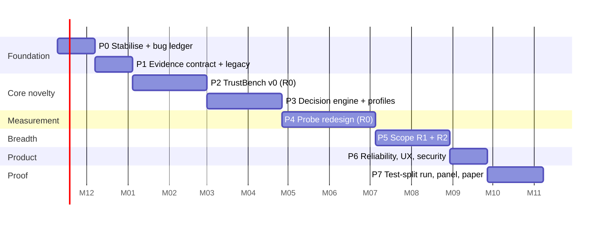

# 07 — Roadmap (12 months)

Horizon is fixed at one year; no external deadline, so quality gates beat dates. The plan holds ~15% explicit slack and a dedicated validation quarter. Weeks are focused solo-developer weeks **[ASSUMPTION: ~25–30 productive h/week; re-estimate after Phase 0]**.

(Dates are placeholders; 52 weeks total including slack.)

## Phases

| Phase | Name | Weeks | Delivers | Exit criteria |
| ----- | ---- | ----- | -------- | ------------- |
| 0 | Stabilise | 4 | Bug ledger, suites green ×3, K1–K10 closed or documented, LLM modules (`osd/hybrid.py`, `osd/llm_client.py`, provider config) removed from the product path, `v1.0-thesis` tag, GPU benchmark of the 4060 (spec 10) | No known high-severity bug; clean-clone CI green; benchmark numbers recorded |
| 1 | Evidence contract | 4 | `EvidenceItem` schema with stored bootstrap draws; v1 probes re-emit it unchanged; `legacy/` move | v1 fixtures still pass; evidence round-trips; golden files |
| 2 | TrustBench v0 | 8 | Manifest, defect generators, reference runner for rung R0 (≥ 24 controlled-defect, ≥ 12 natural models), pre-registration, dev/val/test split by model | Reference CIs computed; reproduces v1 flawed-suite findings as a sanity check; test split sealed |
| 3 | Decision engine | 8 | `risk/` isotonic links, `decision/` Bayes rule, profile presets, VOI planner, API + minimal UI | Spec 03 property tests pass; S2, S3, S5 measured on the **validation** split |
| 4 | Probe redesign (R0) | 10 | Counterfactual fairness, paraphrase/format/calibration robustness, faithfulness explainability, evasion/selective safety, integrity format + opcode scan | Each probe meets spec 02 acceptance; TrustBench rerun; S1 measured on validation |
| 5 | Scope R1 + R2 | 8 | New tasks/languages, tabular backend and probes, black-box endpoint adapter, probe packs, auto-generated pairing table | Rung acceptance (spec 05) for R1 and R2 |
| 6 | Reliability and UX | 4 | Follow-up (VOI) flow, applicability preview, profile editor, limits UI, Playwright happy path, install timing study (S7), security pass | S6, S7 met; security findings closed |
| 7 | Validation and write-up | 6 | Single run on the sealed test split, human panel, literature comparison table, paper/report v2, public TrustBench plan | S1–S5 reported with intervals, failures included |
| — | Slack | 0 reserved inside phases ~7 | Absorbs overruns | Not spent speculatively |

Critical path: 0 → 1 → 2 → 3 → 4 → 7. Phase 5 starts only after Phase 3 shows signal on R0, so breadth never grows around an unvalidated core.

## Milestones (demo-able)

| Month | Milestone | What you can show |
| ----- | --------- | ----------------- |
| 1 | M1 Clean base | Green CI, bug ledger, removed LLM path, benchmarked GPU |
| 3 | M2 Ground truth exists | A TrustBench scorecard: audit vs reference on dev models |
| 5 | M3 The novelty works (or doesn't) | End-to-end Decision with VOI on R0; calibration plot on validation |
| 8 | M4 Better measurements | Redesigned probes; improved ρ/AUROC vs M3 |
| 10 | M5 Wider reach | Tabular models audited; new language |
| 11 | M6 Usable by a stranger | Timed install study; follow-up flow |
| 12 | M7 Proof | Test-split results; paper draft; repo ready to publish |

## Cut lines if reality bites

1. First to go: R3 images, learned stakes (spec 03 step 5), paraphrase robustness requiring an extra model, public TrustBench release.
2. Next: R2 tabular (keep R1 text breadth).
3. Never cut: Phase 0, the sealed test split, honest S1–S5 reporting, ADR 0014 behaviour.

## Top risks

| Risk | Impact | Mitigation |
| ---- | ------ | ---------- |
| Audit does not predict the reference well | Core claim weakens | Diagnose per dimension; fix probes in Phase 4 *before* the test split is touched; a negative result is still reportable |
| TrustBench too small for stable links | Overfit calibration | Monotone low-capacity links, cross-validation by model, shrinkage to prior, intervals everywhere |
| Loss profiles look arbitrary | Credibility | Sensitivity analysis, presets with rationale, show all expected losses |
| GPU time (8 GB, laptop thermals) | Schedule | Budget in spec 10; cache evidence by hash; bf16/fp16; small base models; run reference jobs overnight |
| "Any model" scope creep | Never finishes | Capability ladder; R4 deferred |
| Licence limits on datasets/models | Release | Ship manifests + scripts, redistribute only permitted assets |
| Solo-developer bus factor / burnout | Delivery | Weekly review against milestones; slack; cut lines above |

## Decisions already taken

- Hard-fail evidence is non-overridable (Tier A, ADR 0014).
- LLMs are out of scoring and reports. Phase 0 removes them from the product path; provider keys leave the config.
- One-year horizon, RTX 4060 Laptop (8 GB VRAM) as the reference development machine.

## Open questions

1. Primary output: thesis addendum, conference/workshop paper, public tool, or all three? (Affects Phase 7 content only.)
2. Which one or two extra task domains matter most for R1? Proposal: sentiment and NLI/topic (cheap models, public data), plus one non-English toxicity set.
3. Public release of TrustBench: aim for it, or keep internal? (Licence check is Phase 2.)
4. Is a second person available as an independent reviewer for the human panel (needs ≥ 5)?

## Definition of done

Every success criterion in spec 00 is measured and reported on the untouched test split; the supported-pairing table and probe method cards are generated from code; a stranger can reproduce the headline tables with one documented command.
