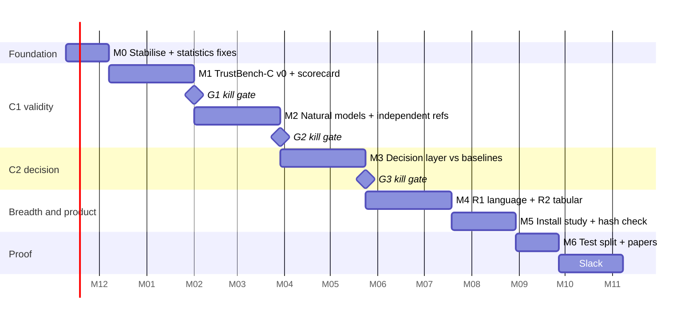

# 07 — Roadmap (12 months)

Horizon is fixed at one year; no external deadline, so quality gates beat dates. The plan has seven milestones M0–M6, three kill-or-continue gates G1–G3, and 6 weeks of slack held centrally (not inside milestones). Weeks are focused solo-developer weeks **[ASSUMPTION: ~25–30 productive h/week; re-estimate after M0]**. Source: DESIGN_SYNTHESIS section 7.

(Dates are placeholders; 52 weeks total including slack.)

## Milestones and gates

| # | Window | Claim supported | Experiment | Success threshold | Fallback if it fails | Artefact |
| - | ------ | --------------- | ---------- | ----------------- | -------------------- | -------- |
| M0 | wk 1–4 | — (foundation) | Bug hunt (spec 01); statistics fixes K11–K14; LLM modules (`osd/hybrid.py`, `osd/llm_client.py`, provider config) removed; pickle allowlist on ≥ 200 real `.bin`; `v1.0-thesis` tag | Suites green ×3; 0 false Tier A on the 200 | Narrow the Tier A list further | bug ledger, `bench-4060.md` (= S1) |
| M1 | wk 5–12 | C1 | TrustBench-C v0: 120 controlled models; score v1 probes and new probes (detection AUROC vs dose, false alarm on 24 clean seeds, coverage of the dose truth) | — (feeds G1) | — | **Probe scorecard v0** (table + dose-response plots) |
| **G1** | **month 3** | **kill-or-continue** | From the M1 scorecard | Per new probe: AUROC ≥ 0.85 at medium dose **and** ≤ 10 % false alarm on clean seeds **and** beats the v1 probe of the same dimension (paired DeLong or bootstrap over models). Also: the v1 failures reproduce (EOD misses V1-dose models; AOPC does not separate) | A failing probe is dropped or redesigned once. If ≥ 3 of 5 dimensions fail, pivot to the **negative-results benchmark** (plan B1) | decision memo |
| M2 | wk 13–20 | C1 (transfer) | ≥ 40 natural Hub models with independent references (spec 04); controlled-vs-natural transfer | ρ(audit, independent ref) ≥ 0.5 for Fairness, Robustness, Safety (ASSUMPTION thresholds, pre-registered before the run) | Report the per-dimension transfer gap; scope claims to construct validity for failing dimensions | TrustBench v0.5 manifest, transfer plot |
| **G2** | **month 5** | kill-or-continue | M2 results | ≥ 2 of 3 referenceable dimensions pass | Plan B2: TrustBench-C alone is the contribution; natural results descriptive | memo |
| M3 | wk 21–28 | C2 | Decision layer vs interval rule vs v1 thresholds on the **validation** split, 4 presets, paired bootstrap over models × presets | Mean realised loss lower than the interval rule, 95 % CI excluding 0 | Plan B3: ship the interval rule as default; report the decision layer as a negative/neutral result | decision-quality plot, sensitivity table |
| **G3** | **month 7** | kill-or-continue | M3 | Pass → keep expected loss as default | Fail → interval rule default, expected loss optional view | memo |
| M4 | wk 29–36 | breadth of C1 | R1: one extra language for counterfactual fairness; R2 tabular stratum (signed group gaps, feature-perturbation flips, integrity for sklearn pickles) | Rung acceptance per spec 05 | Cut R2 first (cut line 2), keep R1 | TrustBench strata R1/R2 |
| M5 | wk 37–42 | usability (S6, S7) | Install study (3 volunteers), cross-machine CPU hash check, follow-up flow and profile editor in the UI, security pass | S6 CPU byte-identical; S7 ≤ 15 min median | Document the gap; fix the top blocker | release candidate |
| M6 | wk 43–46 | C1 + C2 | Single run on the sealed test split; fresh prior-art scan | Pre-registered thresholds | Report as is | **Paper 1: TrustBench (benchmark/datasets track)**; paper 2: decision layer (if G3 passed) |
| slack | 6 wk | — | — | — | absorbs overruns | — |

Each gate is decidable from one plot or table:

- G1: dose–detection curves with an AUROC table and a false-alarm bar per probe.
- G2: a scatter of audit vs independent reference with ρ and CI.
- G3: a paired-difference forest plot.

Critical path: M0 → M1 → G1 → M2 → G2 → M3 → M6. Probe fixes come *before* TrustBench scoring (the first draft benchmarked v1's broken fairness probe first). M4 starts only after G3, so breadth never grows around an unvalidated core.

## Cut lines if reality bites

1. First to go: R3 images, paraphrase robustness requiring an extra model, public TrustBench release.
2. Next: R2 tabular (keep R1 text breadth).
3. Never cut: M0, the sealed test split, honest S1–S5 reporting, ADR 0014 behaviour.

## Top risks

Full register with early signals: DESIGN_SYNTHESIS section 8.

| Risk | Impact | Mitigation |
| ---- | ------ | ---------- |
| Controlled defects do not transfer to natural models | Benchmark validates only synthetic flaws | Several defect mechanisms per dimension; natural stratum; claims scoped per dimension (G2) |
| No independent reference for Explainability/Integrity | No criterion validity there | State construct-only validity |
| Decision layer adds nothing on real validation | C2 weakens | Plan B3 (G3) |
| Single-seed spike results do not replicate | Gate numbers move | 3 seeds per dose from M1 on |
| Loss profiles look arbitrary | Credibility | Sensitivity analysis, presets with rationale, show all expected losses |
| "Any model" scope creep | Never finishes | Capability ladder; R4 deferred |
| Licence limits on datasets/models | Release | Ship manifests + scripts, redistribute only permitted assets (check in M2) |
| Solo-developer bus factor / burnout | Delivery | Gates allow early pivot; central slack; cut lines above |

## Decisions already taken

- Hard-fail evidence is non-overridable (Tier A, ADR 0014); Tier A = versioned denylist hits only.
- LLMs are out of scoring and reports. M0 removes them from the product path; provider keys leave the config.
- TrustBench (C1) is the primary contribution; the decision layer (C2) is secondary.
- No fitted evidence→risk link; no VOI planner (EVPI shown as explanation only).
- One-year horizon, RTX 4060 Laptop (8 GB VRAM) as the reference development machine.

## Open questions

1. Primary output venue. Proposal: benchmark/datasets-track paper for C1 at M6, tool release alongside (DESIGN_SYNTHESIS D7).
2. Which extra language for R1? Lexicon cost is about 2 weeks per language including review [ASSUMPTION].
3. Public release of TrustBench: aim for it, or keep internal? (Licence check is M2.)
4. Is a second person available as an independent reviewer for the human panel (needs ≥ 5)? If not, the panel is dropped without loss to C1.

## Definition of done

Every success criterion in spec 00 is measured and reported on the untouched test split; the supported-pairing table and probe method cards are generated from code; a stranger can reproduce the headline tables with one documented command.
