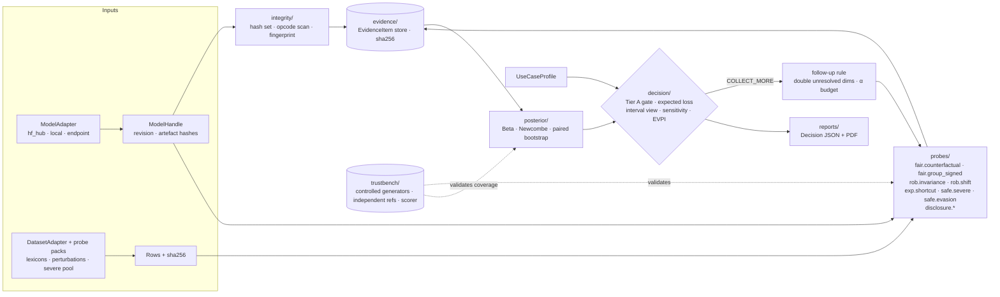
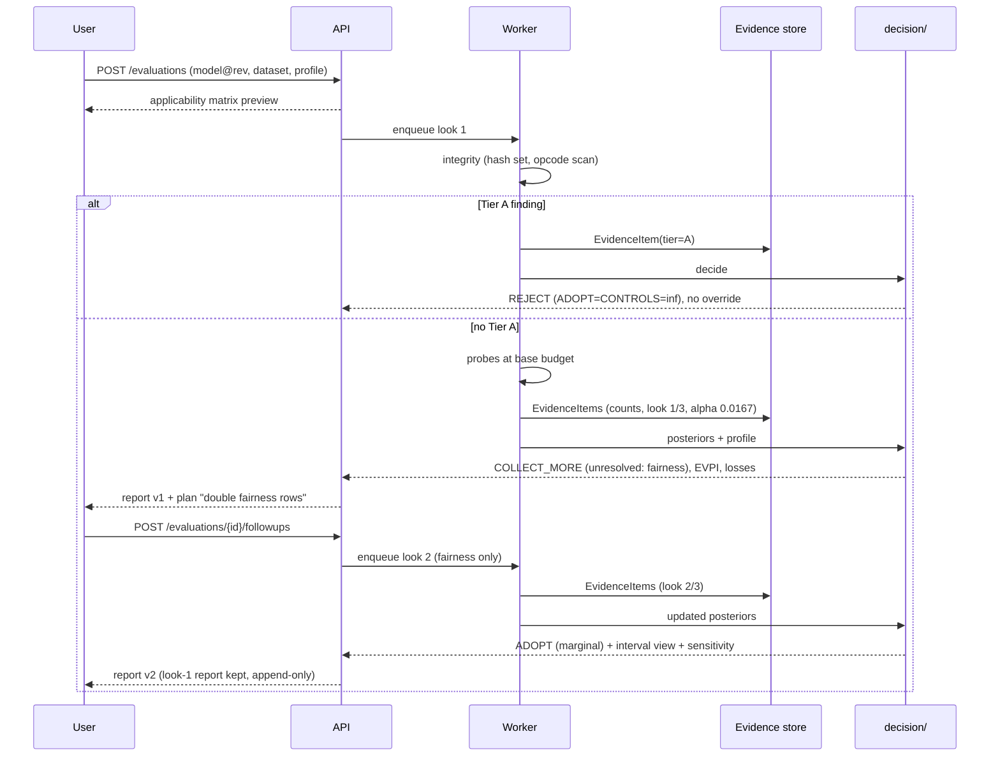

# TrustLens v2 — design synthesis

Status: **recommendation for owner review**, 2026-11-01. Specs 00–11 are unchanged; section 9 lists the edits this document proposes. Spike code and raw numbers: [`spikes/`](spikes/), notes in [`spikes/RESULTS.md`](spikes/RESULTS.md).

Tags: **FACT** = sourced (link in section 10) or measured here (`MEASURED Sx` points to the spike). **INFERENCE** = reasoning from facts. **ASSUMPTION** = needs confirming. Confidence on recommendations: high / medium / low.

---

## 1. Executive summary

### What to build

A **validated audit**: probes whose detection power and false-alarm rate are measured on a large benchmark of dose-controlled defective models. The probes feed a small, transparent decision layer:

1. **Probes (changed).**
   - Fairness becomes a counterfactual identity-swap probe that needs no group labels. It detected v1's fairness defect, which v1's own metric missed (MEASURED S4).
   - Explainability becomes *shortcut reliance* (global attribution discovery plus an insertion test), replacing deletion-curve "faithfulness". AOPC did not separate a shortcut model from a clean one (MEASURED S5).
   - Integrity adds a stdlib, non-executing pickle-opcode scan with a closed denylist for Tier A (MEASURED S7).
   - Robustness and Safety keep the v1 core with fixed statistics.
2. **Evidence (changed).** Rate-type evidence carries counts (k, n) and an exact Jeffreys/Beta posterior. The percentile bootstrap and the max − min gap are retired for small groups: they under-cover (0.39) and are biased (truth 0, estimate 0.23) (MEASURED S3).
3. **Risk (simplified).** No fitted isotonic link. Tolerances are stated on each estimand's own scale, and the posterior is the measurement posterior. TrustBench *validates* coverage and detection instead of *fitting* links. If validation shows a systematic audit-vs-reference shift, use a 2-parameter monotone correction (MEASURED S2).
4. **Decision (kept, narrowed).**
   - Expected-loss Bayes action over ADOPT / ADOPT_WITH_CONTROLS / REJECT.
   - It always shows the interval view and a ±50 % stake-sensitivity panel.
   - It beat a tolerance-and-interval rule in 5/5 simulated scenarios (MEASURED S6).
5. **Follow-up (replaced).** Spec 03's myopic VOI planner is replaced by a capped doubling rule with an α budget. Myopic VOI bought no evidence in multi-dimension cases and lost badly at high stakes (MEASURED S6). EVPI per dimension is shown as an explanation, not used as a planner.
6. **Ground truth (changed).**
   - The primary truth is controlled-defect models, now cheap: about 2.3 GPU-min each (MEASURED S1).
   - Natural-model references must use an *independent instrument or data source*. A same-code reference passes S1 in 100 % of simulations even when true validity is 0.54 (MEASURED S8).

### Novelty claim, as verified

- **Primary contribution.** A **multi-dimension, dose-controlled benchmark that scores the audit probes themselves**: detection-vs-dose curves, false alarms on clean controls, cross-dimension leakage, and interval coverage. It also shows which common probe statistics fail.
  - Closest prior art covers one dimension each: TrojAI (trojan detectors on planted triggers), Domino (slice discovery on known slices), and Zhou et al. (attribution methods on planted features).
  - No source I opened validates a five-dimension adoption audit end to end (INFERENCE, medium confidence: absence of evidence from a bounded search).
- **Secondary contribution.** An applied decision layer with explicit abstention. It is textbook decision theory, novel only in application.
- **Dropped claims.** A calibrated evidence→risk link (N1) is near-tautological under the spec's own reference design. VOI audit planning (N3) failed its spike.

### Three biggest risks

1. Controlled defects do not transfer to natural models, so the benchmark validates only synthetic flaws.
2. An independent reference cannot be built for some dimensions (Explainability, Integrity), so those rest on construct validity only.
3. The expected-loss layer's advantage depends on user-stated stakes. Users may not state them credibly, and the result can look arbitrary.

### First three actions

1. Phase 0 plus statistics fixes: replace the max − min bootstrap and the percentile bootstrap on rates with Jeffreys or Newcombe intervals; add the counts field to evidence. Commit `bench-4060.md` from S1.
2. Build TrustBench-C v0: about 120 controlled-defect BERT-base/DistilBERT models (5 dimensions × 4 doses × 3 seeds + 24 clean). About 5 GPU-h (INFERENCE from S1).
3. Run the month-3 kill gate. Score v1 probes and the new probes (S4/S5/S7 prototypes) on TrustBench-C v0. Continue only with probes that reach detection AUROC ≥ 0.85 at medium dose and ≤ 10 % false alarms on clean seeds.

---

## 2. Verdicts on existing specs and success criteria (T1)

### 2.1 Specs

| Spec | Verdict | Reason | Fix |
| ---- | ------- | ------ | --- |
| 00 Vision | feasible with changes | Thesis sentence OK. S1 cannot fail with a same-code reference (S8), and S4 is ill-posed near the tolerance (S3-D) | Rewrite S1, S2, S4 (2.2) |
| 01 v1 baseline | feasible as written, add items | Verified extra issues: v1 EOD is max − min (`probes/fairness_metrics.py:132`), biased upward (S3-C). `bootstrap_gap_ci` silently drops replicates where a group vanishes (`probes/fairness_stats.py:209-213`), which conditions the CI on group survival. Hand constants confirmed (`confidence/engine.py:119-147`). No pickle scan exists anywhere (grep over `probes/`, `inference/`, `adapters/`) | Add K11–K14 (section 9) |
| 02 Probe redesign | feasible with changes | Counterfactual fairness: validated (S4). `exp.faithfulness` measures the attribution method, not the model (S5). `rob.paraphrase` needs a hashed generator model: fine, but costly. Uncertainty `method: bootstrap` is unsafe for small-n rates (S3-A) | Replace exp.faithfulness with `exp.shortcut`; add counts and Jeffreys; signed gaps |
| 03 Decision engine | feasible with changes | Step 1 isotonic link: not needed under the spec's own reference design, and isotonic is the weakest link at N ≤ 60 (S2). Step 3 Bayes rule: keep (S6). Step 4 myopic VOI: **infeasible as a useful planner** (S6). Step 5 learned stakes: unsupported at panel size ≤ 5 | Drop the link fit and VOI planner; add doubling rule, α budget, EVPI display |
| 04 TrustBench | feasible with changes | Reference = "same probe code at full budget" shares method error with the audit (S8). Controlled models are about 10× cheaper than planned (S1), so N can grow | Independent references per dimension (5.6); controlled-defect stratum ≥ 120 models |
| 05 Scope | feasible as written | R0–R2 fit; R3 inference fits in 8 GB. Counterfactual lexicons per language are the R1 bottleneck (ASSUMPTION: about 2 weeks per language including review) | Keep; R1 = 1 extra language |
| 06 Architecture | feasible with changes | `risk/` shrinks to posterior construction; `decision/` loses VOI. The rest is sound | Module list in 5.7 |
| 07 Roadmap | feasible with changes | Phase order puts TrustBench before probe fixes, so v1's broken fairness probe would be benchmarked first. No kill gates | Section 7 |
| 08 Worked example | feasible with changes | Mechanics OK, but its numbers were hand-made. It uses fitted links and VOI | Replace with the S9 script output (5.4) |
| 09 Related work | feasible with changes | N1 and N3 not supported by the spikes; N4 strongest | Section 3 |
| 10 Compute | feasible as written, estimates wrong | Training 15–30 min/model is 7–13× too high (S1). Total budget still fits | Replace the table (5.8) |
| 11 Glossary/FAQ | feasible with changes | "Link g_d", "VOI" entries change | Section 9 |
| ADR 0013 | feasible as written | — | — |
| ADR 0014 | feasible as written, needs a closed list | S7: a denylist hit is safe to hard-fail. An "unknown callable" must not be (training_args pickles reference `__main__`) | Tier A list = denylist hits only; unknown → Tier B |

### 2.2 Success criteria

| ID | Verdict | Reason | Fix |
| -- | ------- | ------ | --- |
| S1 ρ ≥ 0.7 vs reference | **infeasible as a test** with a same-code reference (always passes, S8); feasible with an independent reference | S8: same-code ρ 0.94–0.98 regardless of truth | Measure against an independent reference; report the same-code ρ only as a budget-consistency check; threshold ρ ≥ 0.5 [ASSUMPTION, fix after M2 pilot] |
| S2 AUROC ≥ 0.9, false-adopt ≤ 5 % | feasible with changes | Fairness at dose 0.4 separates (S4). An unweighted false-adopt rate conflicts with expected-loss optimality: the oracle itself "false-adopts" about 10 % when only low-stake dimensions violate (S6) | Keep the AUROC part per probe on TrustBench-C; replace false-adopt with stake-weighted false-adopt ≤ 5 % on dimensions with stake ≥ the median |
| S3 coverage 85–95 % | feasible with changes | Jeffreys/Wilson/Newcombe meet it at n ≥ 20 (S3). Percentile bootstrap on rates does not (0.39 at n = 10, p = 0.05). Sequential looks break fixed intervals (0.15 error) | Use the Jeffreys/Newcombe family; α spent over ≤ 3 looks; check coverage on TrustBench-C, where truth is known by construction |
| S4 VOI plan decides in ≤ 2 rounds in ≥ 80 % | unknown → reformulate | Near-tolerance models cannot be resolved by any finite budget (S3-D: confidence sequence decided 0 % at p = τ) | "Outside an indifference zone \|rate − τ\| ≥ 0.25·τ, ≥ 80 % of COLLECT_MORE cases resolve within 2 doublings"; inside the zone, commit to the Bayes action and show it as marginal |
| S5 lower loss than v1 thresholds | feasible as written | S6 shows the Bayes action vs the interval rule gap is resolvable with about 1 500 paired cases in simulation; on about 40 validation models the CI will be wide (ASSUMPTION) | Paired bootstrap over models and profile presets |
| S6 byte-identical hashes across machines | feasible with changes | GPU fp16 output is not bit-stable across devices (ASSUMPTION, standard). v1 already hashes raw outputs | Byte identity on the CPU path. The GPU path stores predictions rounded to 4 dp plus a documented tolerance |
| S7 15-min install, 3 volunteers | unknown until study | Depends on Docker on Windows and volunteers | Keep; run in M5 |

### 2.3 The five T1 questions, answered

1. **TrustBench on 8 GB in a year.** Yes, with large margin.
   - A v1-recipe BERT-base model costs about 2.3 min to train (3 × 45.8 s, MEASURED S1). Peak training VRAM is 3.6 GiB at bs 32, and the GPU held 66 °C max.
   - 300 models ≈ 12 GPU-h of training (INFERENCE).
   - The full budget is in 5.8: about 45 GPU-h total. GPU is not the bottleneck; the owner's labelling and review time is (ASSUMPTION).
2. **Monotone link from about 60 models.**
   - Isotonic from 60 models is credible only in the shrinkage sense. It reaches 6 % above its asymptotic error at N = 60 and is *worse than no link* at N = 10 (MEASURED S2).
   - A 2-parameter monotone link needs 20–40 models per dimension.
   - Under the spec's own reference design the link mostly learns shrinkage plus an offset. The recommendation is therefore no fitted link; the 2-parameter correction applies only if validation shows a shift. Confidence medium-high.
3. **Is the reference independent?** No, not as written. A same-code reference shares model-specific method error, so S1 cannot fail (MEASURED S8). The fix is independent instruments per dimension (5.6), with controlled defects as primary truth. Confidence high.
4. **VOI vs a simple rule.**
   - Myopic VOI is worse than the simple doubling rule in 2/5 scenarios (+1.47 loss at high stakes, +0.05 in 1-dim), and it buys zero evidence in every 3-dimension case (MEASURED S6).
   - Non-myopic VOI would fix the zero-purchase problem at the cost of a dynamic program over dimensions × batches. That complexity is not earned (INFERENCE).
   - Keep EVPI per dimension as an explanation ("knowing fairness exactly is worth 0.33 loss units") and drop the planner. Confidence high.
5. **Expected loss vs tolerance-and-interval.** Expected loss wins: −0.02 to −1.12 loss units, CI excluding 0 in 5/5 scenarios, including a misspecified prior (MEASURED S6). The gain comes from using stakes and control credit; it rests on the loss model being stated. Keep it, show the interval view beside it, and report sensitivity. Confidence medium: simulation only, toy loss model.

---

## 3. Prior art and revised novelty (T2)

### 3.1 Table

Every row was opened (section 10). "Lacks" is relative to the claims N1–N4 and the revised claim C1 (3.2).

| Work | What it does | What it lacks vs N1–N4 / C1 | Verdict |
| ---- | ------------ | -------------------------- | ------- |
| AIF360 (Bellamy et al. 2018) | Fairness metrics, pre/in/post-processing mitigation; Apache-2.0 | No cross-dimension decision, no uncertainty-aware action, no validation of the audit | no overlap (N1–N4); probe-level overlap |
| Fairlearn | Group fairness assessment and mitigation; MIT | Same. Whether its MetricFrame offers bootstrap CIs was not confirmed (UNVERIFIED) | no overlap |
| Giskard | v3: red-teaming of LLM agents. v2 tabular/NLP scan (performance, bias, robustness) is no longer maintained; Apache-2.0 | A findings list; no decision with uncertainty; no scanner validation shown | partially overlaps (automated multi-category scan) |
| Responsible AI Toolbox (Microsoft) | Error analysis, Fairlearn, InterpretML, DiCE counterfactuals, EconML causal; MIT | No formal decision output, no uncertainty, no audit validation | partially overlaps (multi-component dashboard) |
| CheckList (Ribeiro et al. 2020) | Behavioural capability tests for NLP | Test authoring; no risk mapping or decision; tests not validated against defect truth | partially overlaps (probe technique: invariance tests) |
| Robustness Gym (Goel et al. 2021) | Subpopulations, transformations, eval sets, attacks | Same | partially overlaps (probe technique) |
| TextAttack (Morris et al. 2020) | Attack/augmentation recipes | Attack success ≠ verdict | no overlap |
| Captum (Kokhlikyan et al. 2020) / SHAP (Lundberg & Lee 2017) | Attribution algorithms (Captum also lists metrics) | Methods, not audits | no overlap (used as instruments) |
| HF Evaluate | Metric/comparison/measurement library; Apache-2.0; README points to LightEval for newer LLM evaluation | No decision, no validation | no overlap |
| Model Cards (Mitchell et al. 2018/FAT* 2019) | Disclosure template including disaggregated evaluation | Disclosure ≠ measurement | no overlap (feeds disclosure probes) |
| HELM (Liang et al. 2022, TMLR 2023) | Broad LLM benchmark: many scenarios and metrics incl. fairness | No per-model adoption decision (confirmed on page) | no overlap |
| DecodingTrust (Wang et al. 2023, NeurIPS D&B) | Eight trust perspectives for GPT-3.5/4 | Benchmark of LLMs; no decision; no audit validation | partially overlaps ("multi-dimension trust", generative only) |
| NIST AI RMF 1.0 (2023) + AI 600-1 (2024) | Voluntary framework (Govern/Map/Measure/Manage) | No executable measurement protocol found on the page | no overlap |
| HF Hub pickle scanning | Every pushed pickle scanned with `pickletools.genops`; imports listed, suspicious ones highlighted; ClamAV; "not 100 % foolproof" | Single dimension; not combined with behaviour | overlaps for `int.format_safety` (reuse the idea, not a novelty) |
| picklescan / modelscan / fickling | Pickle scanners. modelscan reads bytes without loading (Apache-2.0); fickling has an allowlist ML mode (LGPL-3.0) | Single dimension | overlaps with `int.format_safety` |
| MalHug — "Models Are Codes" (Zhao et al. 2024, ASE) | 705K models / 176K datasets monitored; 91 malicious models found; says Fickling/ModelScan fall short semantically | Supply-chain only | overlaps (integrity); evidence that a denylist scan is necessary, not sufficient |
| TrojAI (NIST/IARPA/JHU-APL) | Rounds of models with known planted triggers; detectors scored on sequestered data | One defect type (trojans), detectors not adoption decisions | **partially overlaps C1 methodology** (validate detectors on planted truth) |
| Counterfactual token fairness (Garg et al. 2018/19) | Prediction change under identity-term swap | Metric/training, not audit validation | probe technique reused (S4) |
| Dixon et al. 2018 (AIES); Borkan et al. 2019 | Identity-term templates; threshold-agnostic subgroup metrics with real identity-annotated comments | Metrics, not validation of auditors | probe technique and independent fairness reference (5.6) |
| ERASER (DeYoung et al. 2020) | Faithfulness of rationales (comprehensiveness/sufficiency) | Evaluates explanations, not model trust | technique; S5 shows why it is the wrong property probe |
| Sanity checks (Adebayo et al. 2018) | Saliency independent of model/data fails | Method check | method-card check |
| Zhou et al. 2022 (AAAI), "Do feature attribution methods correctly attribute features?" | Dataset modification creating ground-truth attributions; finds attribution deficiencies | Validates attribution methods, not trust audits | **partially overlaps C1** (planted ground truth, one dimension) |
| Domino (Eyuboglu et al., ICLR 2022) | Quantitative evaluation of slice discovery across 1 235 settings | One task (slice discovery) | partially overlaps C1 methodology |
| Akpinar et al. 2022, bias sandbox | Injects biases to test *remedies* | Tests mitigations, not audits (confirmed on page) | partially overlaps (bias injection) |
| Jacobs & Wallach (FAccT 2021), "Measurement and Fairness" | Construct validity/reliability for fairness measures | Conceptual; no benchmark | supports C1 framing (cite as theory) |
| Ji, Smyth, Steyvers 2020 | Bayesian hierarchical estimation of group fairness metrics with uncertainty | Single dimension; no decision | overlaps with the posterior idea (cite; consider for small groups) |
| Active testing (Kossen et al., ICML 2021); tinyBenchmarks (Maia Polo et al., ICML 2024) | Label- or example-efficient evaluation | Estimate accuracy cheaply; no trust decision | partially overlaps N3 (budget-efficient evaluation) |
| Howard et al. 2021 (Ann. Stat.); Waudby-Smith & Ramdas 2020 | Time-uniform confidence sequences | Statistics only | method for follow-up rounds |
| Selective classification (Geifman & El-Yaniv 2017); Conformal risk control (Angelopoulos et al. 2022) | Abstention per *input* with risk guarantees | Abstain per input, not per adoption decision | no overlap with N2 (different unit) |

### 3.2 Revised novelty statement

| Original | Evidence | Revised |
| -------- | -------- | ------- |
| N1 validated evidence→risk link | S2: under the spec's reference design, a link learns shrinkage plus an offset. Isotonic is weakest at the planned N | **Dropped as a claim.** The posterior is the measurement posterior; coverage is validated |
| N2 decision with abstention | Textbook (Bayes action, EVSI). S6: measurable gain over interval rules in simulation | **Kept as secondary, applied**: "use-case-conditioned expected-loss adoption with explicit abstention, shown to beat interval rules on a benchmark" |
| N3 VOI audit planning | S6: myopic VOI fails; active testing / tinyBenchmarks already cover budget efficiency | **Dropped.** Keep EVPI as an explanation |
| N4 predictive validity of the audit | No five-dimension precedent found. TrojAI, Domino and Zhou et al. do it for one dimension each | **Promoted to the primary claim C1** |

**C1 (primary):** *TrustBench, a dose-controlled, multi-dimension benchmark for validating model-adoption audits, together with the measured finding that several widely used audit statistics fail it, and replacements that pass.* Supported in this session by:

- the max − min gap: biased, 0 % coverage (S3-C);
- the percentile bootstrap on small rates: 0.39 coverage (S3-A);
- the same-code reference: uninformative (S8);
- AOPC as a trust probe: does not separate (S5);
- the equal-opportunity gap: missed v1's planted fairness defect, which the counterfactual probe caught (S4 vs v1 FINAL_RESULTS).

**C2 (secondary):** the decision layer of 5.4, evaluated on C1's benchmark against interval rules and v1 thresholds.

Confidence: medium. The novelty search was bounded (about 30 sources); a missed close competitor is possible, so M6 includes a fresh scan.

---

## 4. Option matrices per dimension and layer (T3)

Weights as given by the prompt, kept unchanged. Validity carries the most weight because the project's claim is validity: 25 % Validity, 15 % Reliability, 15 % Cost, 15 % Breadth, 10 % Uncertainty, 10 % Gameability resistance, 10 % Effort. Scores are 1–5 (5 best). Weighted totals are out of 5. Scores are INFERENCE unless a spike is cited.

### 4.1 Fairness

| Option | Val | Rel | Cost | Breadth | Unc | Game | Effort | Total |
| ------ | --- | --- | ---- | ------- | --- | ---- | ------ | ----- |
| A. v1 max − min EOD with bootstrap (spec current) | 2 (missed V1; biased, S3-C) | 2 | 5 | 2 (needs group labels) | 1 (0 % coverage at k = 4) | 3 | 5 | 2.6 |
| B. Signed per-group TPR/FPR gaps vs pooled, Newcombe / Beta posterior | 3 | 4 | 5 | 2 | 5 | 3 | 4 | 3.6 |
| **C. Counterfactual identity swap on real sentences (mention gap + flip rate)** | 4 (dose-monotone, caught V1, null = 0; S4) | 4 | 5 (3 s/model) | 4 (no labels; text only, lexicon per language) | 4 (paired bootstrap / Beta on flips) | 3 (lexicon known to gamer) | 4 | **4.0** |
| D. Bayesian hierarchical group metrics (Ji et al.) | 3 | 4 | 4 | 2 | 5 | 3 | 2 | 3.3 |
| E. Slice discovery (Domino-style) | 3 | 2 | 3 | 4 | 2 | 4 | 2 | 2.9 |
| F. Borkan subgroup AUC / BPSN on identity-labelled data | 4 | 4 | 4 | 2 (labelled identity data) | 3 | 4 | 4 | 3.6 |

- **Winner: C.** It is the main fairness probe for text; B is reported beside it whenever group labels exist.
- **Runner-up: B/F.** They win whenever the user has group labels and the harm is outcome disparity, not mention sensitivity. F is also the **independent reference** for C (5.6).
- **Failure modes of C:**
  - Lexicon coverage. Identities not in the lexicon are invisible; TrustBench exposes this with defects planted on held-out identity terms.
  - Grammar artefacts from substitution; the null and neutral adjectives control for them.
  - Templates saturate (S4: spread 0.65 on a clean model), so templates are dropped.
  - δ = 0.5-logit per-term bias is borderline at 76 sentences (S4). TrustBench reports the minimum detectable dose vs n.
- Confidence: high for text; not applicable to R2 tabular, where B applies.

### 4.2 Robustness

| Option | Val | Rel | Cost | Breadth | Unc | Game | Effort | Total |
| ------ | --- | --- | ---- | ------- | --- | ---- | ------ | ----- |
| A. v1 char-swap accuracy drop, paired bootstrap | 3 (detected V2 in v1) | 4 | 5 | 3 (needs labels) | 4 | 2 | 5 | 3.6 |
| **B. Label-free invariance flip rate per family (typo, format, case/unicode), Jeffreys on flips, worst family** | 3 | 4 | 5 | 5 (no labels needed) | 5 | 3 | 4 | **4.0** |
| C. Paraphrase/back-translation flip rate with filter (spec) | 4 | 3 | 2 (extra model, ASSUMPTION 1–2 h generation per pack) | 4 | 4 | 4 | 2 | 3.4 |
| D. Natural shift accuracy (user-supplied shift set) | 5 | 4 | 4 | 1 (rarely available) | 4 | 5 | 4 | 3.9 |
| E. Adversarial attack success (TextAttack) | 3 | 2 | 1 | 4 | 3 | 4 | 3 | 2.9 |
| F. Metamorphic relations (CheckList-style) | 4 | 4 | 4 | 3 | 4 | 3 | 2 | 3.6 |

- **Winner: B, plus A when labels exist.** D is used when a shift set exists, and is also the independent reference.
- **Runner-up: D.** It wins whenever a natural shift set exists for the task.
- **Failure modes of B:** flip rate under trivial perturbations under-reports semantic brittleness, and a model can be invariant yet wrong. TrustBench exposes this with an overfit-dose robustness stratum: v1 V2 style, with varying train size and epochs, scored against natural-shift accuracy.
- Confidence: medium.

### 4.3 Integrity

| Option | Val | Rel | Cost | Breadth | Unc | Game | Effort | Total |
| ------ | --- | --- | ---- | ------- | --- | ---- | ------ | ----- |
| A. sha256 set vs authoritative manifest (v1, ADR 0013) | 5 | 5 | 5 | 4 | 5 (exact) | 3 (manifest in folder rewritable) | 5 | 4.6 |
| **B. Stdlib opcode scan, closed denylist → Tier A, unknown → Tier B** | 4 (S7: 0/11 false Tier A; fixtures caught) | 5 | 5 (2.1 GB in 3.9 s) | 3 (pickle formats only) | 5 | 3 (semantic bypasses; MalHug) | 4 | **4.2** |
| C. Depend on modelscan / fickling | 4 | 4 | 4 | 4 (more formats) | 5 | 3 | 5 | 4.1 |
| D. Behavioural fingerprint (hash of outputs on a canary set) | 4 | 4 (fp16 instability) | 5 | 5 (works for endpoints) | 4 | 4 | 4 | 4.2 |
| E. Signature/provenance (Sigstore-type) | 5 | 5 | 4 | 1 (rarely present) | 5 | 5 | 2 | 4.0 |

- **Winner: A + B + D.**
- **Runner-up: C.** It wins if formats beyond pickle (Keras H5, SavedModel) enter scope; modelscan is Apache-2.0. Prefer it over fickling, whose LGPL-3.0 terms are acceptable for a tool dependency but need the owner's decision.
- **Failure modes:**
  - Denylist evasion through allowed-callable gadget chains. MalHug reports that semantic analysis is needed. TrustBench's tampered stratum includes one gadget-style fixture, known to evade B, to state the ceiling honestly.
  - The allowlist is too narrow (Tier B noise). Extend the real-file sample to a few hundred in M0.
- Confidence: high.

### 4.4 Explainability (renamed in reports: "Shortcut reliance and explanation")

| Option | Val | Rel | Cost | Breadth | Unc | Game | Effort | Total |
| ------ | --- | --- | ---- | ------- | --- | ---- | ------ | ----- |
| A. Model-card coverage (v1) | 1 (documentation; gameable K6) | 4 | 5 | 5 | 1 | 1 | 5 | 2.8 → becomes the `disclosure` probe |
| B. Occlusion AOPC faithfulness (spec) | 2 (S5: does not separate) | 3 | 4 | 4 | 3 | 3 | 4 | 3.1 |
| **C. Shortcut reliance: global occlusion ranking → candidate tokens → insertion/deletion flip test** | 4 (S5: rank 1 vs 55, flip 1.00 vs 0.01) | 4 | 4 (about 5 s / 1 000 short rows) | 3 (needs the artefact in the audit data for discovery) | 4 (Jeffreys on flips) | 3 | 3 | **3.7** |
| D. Attribution sanity / randomisation (Adebayo) | 2 (method check) | 4 | 3 | 3 | 2 | 3 | 4 | 2.9 |
| E. Data attribution / influence | 3 | 2 | 1 | 2 (needs train data) | 2 | 4 | 1 | 2.3 |

- **Winner: C.** B and D move to the method card as checks on the attribution instrument.
- **Runner-up: B.** It wins only if the owner wants Explainability to mean "are the explanations the tool shows correct", a property of the tool, not the model.
- **Failure modes of C:** it cannot discover a shortcut that is absent from audit data. TrustBench's explainability stratum varies how often the trigger appears in audit data (0–50 %) and reports detection vs prevalence. Multi-token or semantic shortcuts are missed by single-word occlusion.
- Confidence: medium.

### 4.5 Safety

| Option | Val | Rel | Cost | Breadth | Unc | Game | Effort | Total |
| ------ | --- | --- | ---- | ------- | --- | ---- | ------ | ----- |
| **A. Severe-miss FNR with Jeffreys/Wilson (v1, kept)** | 4 (dose ρ = 1.0 in v1) | 4 | 5 | 2 (needs severe labels) | 5 | 4 | 5 | **4.1** |
| B. Evasion transforms miss rate on harmful rows | 4 | 4 | 5 | 3 | 5 | 3 | 4 | 4.0 |
| C. Selective risk–coverage (AURC) | 3 | 4 | 5 | 4 | 3 (bootstrap) | 3 | 4 | 3.6 |
| D. Card disclosure checklist (v1) | 1 | 4 | 5 | 5 | 1 | 1 | 5 | 2.7 → disclosure |

- **Winner: A + B.** Both share the counts → Jeffreys path.
- **Runner-up: C.** It wins for profiles where the controls are "abstain and route to human".
- **Failure modes:** the severe subset is small (282 rows in v1). Jeffreys covers small n (S3-A), but the interval stays wide; the doubling rule needs a larger severe pool, so ship a bigger severe pack (ASSUMPTION: from Civil Comments `severe_toxicity`).
- Confidence: high.

### 4.6 Cross-cutting layers

| Layer | Options (score /5) | Winner | Runner-up, and when it wins | Winner's failure mode → how TrustBench exposes it |
| ----- | ------------------ | ------ | --------------------------- | ------------------------------------------------- |
| Evidence contract | spec EvidenceItem (3.6); **+counts, estimand, look/α fields (4.3)**; full raw-output-only (3.0) | +counts etc. (5.1) | Raw-only, if every probe becomes non-rate | Mis-declared estimand direction → property test plus TrustBench dose monotonicity |
| Uncertainty | percentile bootstrap (2.6, S3); **Jeffreys/Wilson/Newcombe exact family + paired bootstrap for continuous (4.4)**; conformal (3.0: guarantees per input, wrong unit); confidence sequences (3.6: 2× width, S3-D); hierarchical Bayes (3.6) | exact family + α-spending over ≤ 3 looks | Confidence sequences, if follow-up rounds become unbounded | Coverage checked on TrustBench-C where the dose is known |
| Risk link | isotonic (2.9, S2); **none: tolerance on estimand scale + measurement posterior (4.2)**; 2-param monotone correction (3.9) | none | 2-param correction, if validation shows a systematic audit/reference shift > half the tolerance | Shift appears as a biased coverage curve |
| Decision rule | interval rule (3.5); **expected loss + interval view + sensitivity (4.0, S6)**; weighted sum (2.5); v1 FRIES (2.2) | expected loss | Interval rule, if users will not state stakes; it is then the default preset ("unit stakes"), shown anyway | Profile sensitivity flips → reported per decision |
| Audit planning | myopic VOI (2.4, S6); non-myopic VOI (2.8, effort); **doubling rule + α budget + EVPI display (4.1)**; fixed budget (3.4) | doubling rule | Fixed budget, if users want predictable cost | Rounds-to-decision outside the indifference zone (new S4) |
| Ground truth | same-code reference (1.9, S8); **controlled defects primary (4.5) + independent-instrument reference for natural models (3.8)**; human panel (2.5: v1 independence unresolved) | controlled + independent | Human panel, only as secondary | Controlled-vs-natural transfer gap reported per dimension |

---

## 5. Integrated architecture (T4)

### 5.1 Evidence contract (revised `EvidenceItem`)

```
EvidenceItem {
  id:            "<dimension>.<probe>.<statistic>"
  kind:          "property" | "disclosure"
  estimand:      { name, scale: "rate"|"difference"|"bool"|"count",
                   direction: "higher_is_worse"|"higher_is_better",
                   reference: "pooled"|"<group>"|null }               # signed, never max-min
  estimate:      float
  n:             int
  counts:        { k: int, n: int } | null       # REQUIRED for rate estimands -> exact posterior
  uncertainty:   { method: "jeffreys"|"wilson"|"newcombe"|"paired_bootstrap"|"exact"|"none",
                   level: float, interval: [lo, hi], draws?: [float] (<=1000, continuous only) }
  look:          { index: int, max_looks: int, alpha_spent: float }      # follow-up rounds
  applicability: "applicable" | "not_applicable(reason)" | "insufficient_evidence(reason)"
  tier:          "A" | "B" | null                 # integrity only; A list closed by ADR 0014
  inputs:        { model_ref@revision, dataset_sha256, config, seed, methodology_version,
                   instrument_hashes: {lexicon, perturbation_pack, attribution_method} }
  evidence_ref:  sha256 of stored raw outputs (predictions rounded to 4 dp on the GPU path)
}
```

Changes from spec 02: `counts`, `estimand.reference`, `look`, `tier` and `instrument_hashes`. Bootstrap draws are optional and used for continuous statistics only.

### 5.2 Uncertainty → posterior

- **Rate estimands** (flip rates, severe FNR, insertion flips): the posterior is Beta(k + ½, n − k + ½). It is exact and cheap, and covered at n ≥ 10 in S3-A.
- **Differences of rates** (signed group gaps): the posterior is the difference of the Beta draws. Coverage 0.935–0.953 (S3-B).
- **Continuous estimands** (mention gap, accuracy drop): paired-bootstrap draws, used only when n ≥ 50 (ASSUMPTION threshold; S3-B shows bootstrap ≥ 0.93 at n ≥ 20 for differences).
- **Independence across dimensions.** Dimensions are measured on disjoint rows or disjoint perturbations of the same rows. Given a fixed model, the posteriors are treated as independent.
  - Correlation of *true* properties across models (v1: the overfit V2 was also less fair, EOD 0.370) affects only the population prior, which the design does not use.
  - **A joint model is not warranted** (INFERENCE). TrustBench reports the cross-dimension leakage matrix to check it.
  - Exception: if two evidence items in one dimension share rows (for example typo and format flips), combine them by **taking the worst family**, never by averaging. This needs no joint model.

### 5.3 Risk and decision rule

- **No fitted link.** Profiles state tolerance τ on each estimand's scale. For example: identity-mention gap ≤ 0.05, worst robustness family flip ≤ 0.15, severe FNR ≤ 0.40. P(violation_d) = P(estimand_d > τ_d | evidence).
- For each dimension, use the binding estimand: the item with the highest P(violation).
- Losses are as in spec 03 step 3. Tier A sets ADOPT = CONTROLS = ∞.
- Output fields:
  - all three expected losses;
  - the Bayes action;
  - the interval view (Bonferroni-adjusted over planned looks);
  - EVPI per dimension;
  - the stake-sensitivity panel (which ±50 % change flips the action).
- **Follow-up rule.**
  - If any dimension has 0.05 < P(violation) < 0.95, and looks < 3, and data remains: return COLLECT_MORE_EVIDENCE with the plan "double rows on those dimensions".
  - Otherwise commit to the Bayes action and label it *marginal* when an interval still straddles τ.
- Abstention with no applicable evidence on a dimension with stake > 0: COLLECT_MORE_EVIDENCE (unchanged). With no data left: `INSUFFICIENT_EVIDENCE` is reported, and the Bayes action is computed under an uninformative Beta(½, ½) per dimension. It is shown, but never ADOPT unless the stakes make it so.

### 5.4 Worked example (script-reproduced, `MEASURED S9`)

Profile `content-moderation`: control cost 1.5, reject cost 6. Severe-miss input [v1]: unitary/toxic-bert, 100/282. Other inputs are illustrative.

| Look | fairness flips k/n (τ 0.05, stake 4) | P(viol) | safety severe miss (τ 0.40, stake 5) | P(viol) | E[ADOPT] | E[CONTROLS] | E[REJECT] | Action |
| ---- | ------------------------------------ | ------- | ------------------------------------ | ------- | -------- | ----------- | --------- | ------ |
| 1 | 5/76 = 0.066, interval [0.020, 0.158] | 0.751 | 100/282 = 0.355 [0.289, 0.425] | 0.060 | 3.303 | **3.121** | 6.0 | COLLECT_MORE (fairness, safety unresolved). EVPI fairness 0.328 |
| 2 | 6/152 = 0.039 [0.013, 0.090] | 0.290 | 204/564 = 0.362 [0.314, 0.411] | 0.031 | **1.313** | 2.141 | 6.0 | COLLECT_MORE (fairness) |
| 3 | 13/304 = 0.043 [0.021, 0.077] | 0.292 | unchanged | 0.031 | **1.323** | 2.146 | 6.0 | **ADOPT (marginal: fairness interval straddles τ)** |

Robustness flips 61/1000 and shortcut flips 3/300 give P(viol) ≈ 0 throughout. With a Tier A finding (for example `builtins.eval` in `pytorch_model.bin`), the output is REJECT, with ADOPT = CONTROLS = ∞, irrespective of the table.

Unlike spec 08, the system says "marginal" instead of implying a clean pass.

### 5.5 Audit planning (what survives)

- Doubling rule: at most 3 looks, α = 0.05 split evenly (S3-D shows why).
- EVPI per dimension in the report.
- Applicability matrix preview (unchanged from spec 05).
- Removed: preposterior simulation, VOI ranking of candidate probes, `followups` scoring by net value. The follow-up endpoint remains, and runs "double rows on the unresolved dimensions".

### 5.6 Ground truth (TrustBench) — independent references

| Dimension | Primary truth (controlled defects, dose knob) | Independent reference for natural models | Shares error with the audit? |
| --------- | --------------------------------------------- | ---------------------------------------- | ---------------------------- |
| Fairness | identity-attack label flip 0–1.0 (v1 sweep generator) and identity-mention flip; per-term logit wrapper (S4) | Subgroup AUC / BPSN-style metrics on held-out identity-*annotated* Civil Comments rows (Borkan et al. data). Different instrument (labels, not swaps), different rows | No (different construct path) |
| Robustness | train size / epochs (overfit), no augmentation vs augmentation | Accuracy drop on a *natural* shifted source for the same task (for example another toxicity corpus; ASSUMPTION: licence check in M2) | No |
| Integrity | byte flips, extra shard, denylist pickle fixtures, gadget fixture (known to evade) | n/a: construct truth only | — |
| Explainability (shortcut) | trigger token at prevalence 0–90 %, multi-token trigger | n/a: construct truth only; state it | — |
| Safety | severe-row relabel rate 0–1.0 (v1 sweep generator) | Severe-miss on a disjoint severe pool, large n | Partly (same estimand, different rows): report as a budget-consistency check, not validity |

Corpus target: TrustBench-C ≥ 120 controlled (3 seeds per dose), ≥ 40 natural, ≥ 12 tampered, split by model 50/20/30, test sealed.

### 5.7 Modules and migration





| v1 module | Fate | Why |
| --------- | ---- | --- |
| `storage/evidence_store.py` | **keep** → `evidence/` | Sound append-only sha256 store |
| `probes/fairness_stats.py` | keep the Wilson helper; **retire** `bootstrap_gap_ci` with max − min stat_fn for decisions | Biased, under-covering (S3-C); silent replicate dropping |
| `probes/fairness.py`, `fairness_multiclass.py` | refactor into `fair.group_signed` | Keep data plumbing and label-mapping guards |
| `probes/robustness*.py` | keep the paired bootstrap for accuracy drop; add label-free flip families | Detected V2 in v1 |
| `probes/safety_behavior*.py` | **keep**; switch to Jeffreys and emit counts | Dose ρ = 1.0 in v1 |
| `probes/integrity_artifact.py`, `integrity*.py` | **keep**; add the opcode scan (S7 code as seed) | ADR 0013 is sound |
| `probes/explainability_card.py`, `safety_card.py` | keep as `disclosure.*` | Never property evidence |
| `confidence/engine.py` | **remove from main path** → `legacy/` | Hand constants; replaced by posterior width |
| `osd/agent.py`, `deterministic.py`, `review.py`, `scoring/fries.py` | `legacy/` (frozen view) | Continuity only |
| `osd/hybrid.py`, `osd/llm_client.py` | **delete** (after archiving the pending diff) | No LLMs (constraint) |
| `inference/local_hf.py`, `device.py` | keep; add fp16 path and output rounding | S1: fp16 is 2.8× faster |
| `datasets/url_fetch.py`, `user_dataset.py` | keep; security pass | — |
| `schemas/evaluation_contract_v2.py` | keep; add `profile` and `looks` | Already per-dimension |
| `scripts/train_flawed_suite.py` | **promote** to `trustbench/generators` | Proven generator |

### 5.8 Compute budget (recomputed from S1)

| Workload | Count | Per unit | Total | Basis |
| -------- | ----- | -------- | ----- | ----- |
| Train controlled models (BERT-base, 3 ep, 8k rows) | 300 | 2.3 min | 11.5 GPU-h | MEASURED S1 |
| Reference inference, natural + controlled (30k rows, 10 perturbation passes) | 340 | 11 × 30k / 825 rows·s⁻¹ ≈ 6.7 min | 38 GPU-h | MEASURED S1 throughput; pass count ASSUMPTION |
| Counterfactual probe | 340 × 5 seeds | 3 s | 1.5 GPU-h | MEASURED S4 |
| Shortcut probe (occlusion, 1 000 Civil-Comments-length rows) | 340 | ≈ 50 s | 4.7 GPU-h | S5 measured 5 s/1 000 on short SST-2 rows; ×10 for length and BERT-base is ASSUMPTION |
| Audit runs, 3 budgets × 5 seeds | 340 × 15 | ≤ 1 min | ≤ 85 GPU-h worst case, ≈ 20 realistic | ASSUMPTION |
| **Total** | | | **≈ 75 GPU-h realistic, ≈ 140 worst case** | ≈ 2–3 weeks of overnight runs |

---

## 6. Spike results and what each changed (T5)

| Spike | Key number | Design change |
| ----- | ---------- | ------------- |
| S1 GPU | BERT-base 175 train rows/s (bs 32, fp16), 3.6 GiB peak, 66 °C; inference 825 rows/s fp16 | TrustBench-C enlarged to ≥ 120 controlled models; spec 10 table replaced |
| S2 Link | Isotonic worse than identity at N = 10; 2-param ≥ isotonic at N ≤ 100; links mostly shrink | No fitted link; tolerance on the estimand scale |
| S3 Intervals | Bootstrap/Wald 0.39 coverage (n = 10, p = 0.05); max − min gap 0 % coverage at truth 0 (k = 4); peeking 0.151 error vs nominal 0.025 | Jeffreys/Newcombe; signed gaps; α over ≤ 3 looks |
| S4 Counterfactual | V1 mention gap 0.067 [0.049, 0.087] vs clean 0.016 [0.009, 0.026]; dose-monotone; null exactly 0; per-term δ ≥ 1 logit detected | Counterfactual probe becomes primary fairness probe |
| S5 Faithfulness | AOPC−random 0.28 vs 0.33 (wrong direction, natural data); trigger rank 1 vs 55; insertion flip 1.00 vs 0.01 | Explainability → shortcut reliance; AOPC → method card |
| S6 VOI | Myopic VOI +1.47 loss at high stakes, 0 rows bought in 3-dim; Bayes action −0.02 to −1.12 vs interval in 5/5 | VOI planner dropped; expected-loss kept |
| S7 Pickle | 0/11 false Tier A on real Hub `.bin`; 2/2 `training_args.bin` → Tier B; 2.1 GB in 3.9 s | Closed denylist = Tier A; unknown = Tier B |
| S8 Reference | Same-code ρ 0.94–0.98 regardless of true ρ (0.54–0.95); passes S1 100 % | Independent references; S1 rewritten |
| S9 Example | Section 5.4 table | Spec 08 replaced |

All spikes are single-seed at the model level (S4, S5): one trained model per dose. Seed variance of the probes is the first M1 job.

---

## 7. Milestones with kill gates (T6)

Assumes about 25–30 productive h/week (spec 07 ASSUMPTION), 52 weeks, 6 weeks of slack held centrally.

| # | Window | Claim supported | Experiment | Success threshold | Fallback if it fails | Artefact |
| - | ------ | --------------- | ---------- | ----------------- | -------------------- | -------- |
| M0 | wk 1–4 | — (foundation) | Phase 0 bug hunt; statistics fixes (K11–K14); pickle allowlist on ≥ 200 real `.bin` | Suites green ×3; 0 false Tier A on the 200 | Narrow the Tier A list further | bug ledger, `bench-4060.md` (= S1) |
| M1 | wk 5–12 | C1 | TrustBench-C v0: 120 controlled models; score v1 probes and new probes (detection AUROC vs dose, false alarm on 24 clean seeds, coverage of the dose truth) | — | — | **Probe scorecard v0** (table + dose-response plots) |
| **G1** | **month 3** | **kill-or-continue** | From the M1 scorecard | Per new probe: AUROC ≥ 0.85 at medium dose **and** ≤ 10 % false alarm on clean seeds **and** beats the v1 probe of the same dimension (paired DeLong or bootstrap over models). Also: the v1 failures reproduce (EOD misses V1-dose models; AOPC does not separate) | A probe that fails is dropped or redesigned once. If ≥ 3 of 5 dimensions fail, the project pivots to the **negative-results benchmark** (plan B1) | decision memo |
| M2 | wk 13–20 | C1 (transfer) | ≥ 40 natural Hub models with independent references (5.6); controlled-vs-natural transfer | ρ(audit, independent ref) ≥ 0.5 for Fairness, Robustness, Safety (ASSUMPTION thresholds, pre-registered before the run) | Report the per-dimension transfer gap; scope claims to construct validity for failing dimensions | TrustBench v0.5 manifest, transfer plot |
| **G2** | **month 5** | kill-or-continue | M2 results | ≥ 2 of 3 referenceable dimensions pass | Plan B2: TrustBench-C alone (controlled) is the contribution; natural results descriptive | memo |
| M3 | wk 21–28 | C2 | Decision layer vs interval rule vs v1 thresholds on the **validation** split, 4 presets, paired bootstrap over models × presets | Mean realised loss lower than the interval rule, 95 % CI excluding 0 | Plan B3: ship the interval rule as default; report the decision layer as a negative/neutral result | decision-quality plot, sensitivity table |
| **G3** | **month 7** | kill-or-continue | M3 | Pass → keep expected loss as default | Fail → interval rule default, expected loss optional view | memo |
| M4 | wk 29–36 | breadth of C1 | R1: one extra language for counterfactual fairness; R2 tabular stratum (signed group gaps, feature-perturbation flips, integrity for sklearn pickles) | Rung acceptance per spec 05 | Cut R2 first (spec 07 cut line), keep R1 | TrustBench strata R1/R2 |
| M5 | wk 37–42 | usability (S6, S7) | Install study (3 volunteers), cross-machine CPU hash check | S6 CPU byte-identical; S7 ≤ 15 min median | Document the gap; fix the top blocker | release candidate |
| M6 | wk 43–46 | C1 + C2 | Single run on the sealed test split; fresh prior-art scan | Pre-registered thresholds | Report as is | **Paper 1: TrustBench (benchmark/datasets track)**; paper 2: decision layer (if G3 passed) |
| slack | 6 wk | — | — | — | absorbs overruns | — |

Each gate is decidable from one plot or table:

- G1: dose–detection curves with an AUROC table and a false-alarm bar per probe.
- G2: a scatter of audit vs independent reference with ρ and CI.
- G3: a paired-difference forest plot.

---

## 8. Risks and plan B (T7)

| Rank | Risk | P | Impact | Early signal | Mitigation |
| ---- | ---- | - | ------ | ------------ | ---------- |
| 1 | Controlled defects do not transfer to natural models | M | H | G2 transfer gap | Several defect mechanisms per dimension; natural stratum; claims scoped per dimension |
| 2 | No independent reference for Explainability/Integrity | H | M | Already known | State construct-only validity; do not claim criterion validity there |
| 3 | Decision layer adds nothing on real validation | M | M | G3 | Plan B3 |
| 4 | Lexicon-based fairness is gamed or misses identities | M | M | Held-out-term defects in M1 | Lexicon versioned; held-out-term stratum; signed group gaps when labels exist |
| 5 | Single-seed spike results do not replicate | M | M | M1 seeds | 3 seeds per dose from M1 on |
| 6 | Licence blocks redistribution of models/datasets | M | L | M2 licence check | Ship generators and manifests, not weights |
| 7 | Scope creep into R3/R4 | M | M | — | Cut lines unchanged |
| 8 | Solo burnout / time | M | H | Missed gate dates | Gates allow early pivot; slack held centrally |
| 9 | A close competitor appears | L | M | M6 scan | C1 benchmark data remains useful as a resource |

**Plan B for the top three:**

- **B1 (G1 fails broadly).** Publish *"Auditing the auditors: common model-audit statistics fail dose-controlled tests"*. The measured failures alone are a negative-results paper with a reusable benchmark:
  - the max − min gap's bias;
  - bootstrap under-coverage;
  - the same-code reference artefact;
  - AOPC's non-separation;
  - EOD missing planted bias.
- **B2 (transfer fails).** TrustBench-C plus construct-validity results; natural-model results reported descriptively, as v1 did for the Hub models.
- **B3 (decision layer adds nothing).** The contribution is C1 plus a validated interval-rule auditor with abstention. Stating "decision theory did not beat intervals on this benchmark" is itself a finding.

**Honest worst case.** Every probe fails G1 and nothing transfers. What remains publishable:

- the S3/S8 statistical findings, generalised over the benchmark;
- the v1 → v2 fairness probe contrast (S4 vs v1 EOD);
- the TrustBench-C generators as an open resource.

That is a workshop paper, not a main-track paper.

---

## 9. Changes required to specs 00–11 (apply only after owner approval)

**Status (2026-11-02):** all rows approved and applied (02, 03, 10 first; 00, 01, 04, 06, 07, 08, 09, 11 and ADR 0014 second). Spec 08 numbers are the S9 output; its profile-flip section (fairness stake 10) is hand arithmetic on the S9 posteriors.

| File | Section | Old | New |
| ---- | ------- | --- | --- |
| 00 | Thesis | "…a decision layer that reasons over the audit's uncertainty … makes better decisions than fixed score thresholds" | Keep; prepend "Audit probes can be validated on dose-controlled defects, and validated probes predict independent references" (C1 first) |
| 00 | S1 | ρ ≥ 0.7 vs reference | ρ vs an **independent** reference (5.6), threshold pre-registered after the M2 pilot (proposal 0.5); same-code ρ reported as budget consistency only |
| 00 | S2 | false-adopt ≤ 5 % | stake-weighted false-adopt (stake ≥ median) ≤ 5 %; per-probe AUROC ≥ 0.85 at medium dose on TrustBench-C |
| 00 | S3 | 90 % credible intervals cover reference | Coverage checked on controlled models (dose truth); intervals from the exact family; α over ≤ 3 looks |
| 00 | S4 | VOI plan decides in ≤ 2 rounds in ≥ 80 % | Outside indifference zone \|rate − τ\| ≥ 0.25τ: ≥ 80 % resolve within 2 doublings |
| 00 | S6 | byte-identical across machines | byte-identical on CPU path; GPU path rounds predictions to 4 dp with documented tolerance |
| 01 | Suspected issues | K1–K10 | Add **K11**: EOD/F1 spread is max − min (`fairness_metrics.py:132`), biased upward (S3-C). **K12**: `bootstrap_gap_ci` drops None replicates (`fairness_stats.py:209-213`), so the CI is conditional on group survival. **K13**: percentile bootstrap used for small-n rates (S3-A). **K14**: no pickle-content scan exists |
| 02 | Evidence contract | spec 02 schema | 5.1 schema (counts, estimand.reference, look, tier, instrument_hashes) |
| 02 | Fairness | `fair.group_gap` worst-group / max − min; templates | `fair.counterfactual` (real sentences, mention gap + flip rate) primary; `fair.group_signed` (signed vs pooled, Newcombe/Beta); templates removed; `fair.intersectional` only with Bonferroni upper bound |
| 02 | Robustness | five families incl. paraphrase | `rob.invariance` (label-free flips per family, worst family) + v1 accuracy drop + `rob.shift`; paraphrase moved to cut-line 1 |
| 02 | Explainability | `exp.faithfulness` (AOPC), `exp.stability`, `exp.sanity` | `exp.shortcut` (global attribution discovery + insertion/deletion flips); AOPC and sanity checks move to the method card; `exp.stability` deferred |
| 02 | Integrity | "dangerous opcodes (GLOBAL/REDUCE to non-allowlisted callables)" | Denylist hit → Tier A; non-allowlisted unknown → Tier B (S7: `training_args.bin`) |
| 03 | Step 1 | Isotonic link g_d fitted on TrustBench | Removed. Tolerances on the estimand scale; posterior = measurement posterior; optional 2-param monotone shift correction only if validation shows bias |
| 03 | Step 4 | VOI preposterior planner | Doubling rule, ≤ 3 looks, α split; EVPI per dimension displayed |
| 03 | Step 5 | Learned stakes | Removed (panel too small) |
| 03 | Properties | "Monotone: more data with same estimate never widens the posterior" | Keep; add "follow-up rounds spend α; looks ≤ 3" property test |
| 04 | Reference protocol | "Same probe code at full budget" | Independent instrument or data per 5.6; same-code runs labelled "budget consistency" |
| 04 | Corpus | ≥ 24 controlled, ≥ 24 natural, ≥ 6 tampered, ≥ 6 clean | ≥ 120 controlled (3 seeds × dose), ≥ 40 natural, ≥ 12 tampered incl. one known-evading gadget fixture, ≥ 24 clean seeds |
| 04 | Defect catalogue, Explainability | "attributions are unfaithful" | "model relies on an artefact token; dose = trigger prevalence in train and in audit data" |
| 06 | Module layout | `risk/` links | `posterior/`; `decision/` without VOI; `trustbench/generators` from `scripts/train_flawed_suite.py` |
| 06 | API | `followups` runs "recommended VOI step" | runs "double rows on unresolved dimensions" |
| 07 | Phases | P0→P1→P2→P3→P4… | Section 7 milestones M0–M6 with gates G1–G3 |
| 08 | All | hand-made numbers, links, VOI table | S9 output (5.4); keep the profile-flip section |
| 09 | Claims | N1–N4 | C1 primary, C2 secondary; N1, N3 dropped with reasons (3.2); landscape table replaced by 3.1 |
| 10 | Budget table | 15–30 min training, 60–120 GPU-h | 5.8 table |
| 11 | Glossary | "Link g_d", "VOI" | "Estimand", "Look/α budget", "EVPI (display only)"; FAQ "Why isotonic links?" → "Why no fitted link?" |
| ADR 0014 | Tier A list | "pickle scan finds a dangerous callable" | "…a callable on the versioned denylist (`integrity/denylist-v1`)"; unknown callables are Tier B |

---

## 10. Sources

### 10.1 Opened in this session

| # | Source | Verified |
| - | ------ | -------- |
| 1 | AIF360 — Bellamy et al. 2018, arXiv:1810.01943; https://github.com/Trusted-AI/AIF360 | Metrics + mitigation; Apache-2.0; no decision/validation features on page |
| 2 | Fairlearn — https://github.com/fairlearn/fairlearn | Assessment + mitigation; MIT |
| 3 | Giskard — https://github.com/Giskard-AI/giskard | v3 targets LLM agents; v2 tabular scan unmaintained; Apache-2.0 |
| 4 | Responsible AI Toolbox — https://github.com/microsoft/responsible-ai-toolbox | Components listed; MIT; no decision/uncertainty stated |
| 5 | HF Hub pickle scanning — https://huggingface.co/docs/hub/security-pickle | `pickletools.genops` import scan + ClamAV; "not 100 % foolproof"; proposes an import allowlist |
| 6 | picklescan — https://github.com/mmaitre314/picklescan | Flags dangerous globals; MIT; internals not documented |
| 7 | fickling — https://github.com/trailofbits/fickling | Symbolic execution; ML allowlist mode; LGPL-3.0 |
| 8 | modelscan — https://github.com/protectai/modelscan | Pickle/H5/SavedModel; reads bytes without loading; Apache-2.0 |
| 9 | CheckList — Ribeiro, Wu, Guestrin, Singh 2020 (ACL); https://arxiv.org/abs/2005.04118 | Behavioural testing |
| 10 | Robustness Gym — Goel et al. 2021; https://arxiv.org/abs/2101.04840 | Four evaluation idioms |
| 11 | TextAttack — Morris et al. 2020; https://arxiv.org/abs/2005.05909 | Attack framework |
| 12 | Captum — Kokhlikyan et al. 2020; https://arxiv.org/abs/2009.07896 | Attribution library |
| 13 | SHAP — Lundberg & Lee 2017; https://arxiv.org/abs/1705.07874 | Unified attribution |
| 14 | HELM — Liang et al. 2022/TMLR 2023; https://arxiv.org/abs/2211.09110 | No adoption decision |
| 15 | HF Evaluate — https://github.com/huggingface/evaluate | Metrics/comparisons/measurements; points to LightEval; Apache-2.0 |
| 16 | Model Cards — Mitchell et al. 2018; https://arxiv.org/abs/1810.03993 | Disclosure framework |
| 17 | NIST AI RMF — https://www.nist.gov/itl/ai-risk-management-framework | 1.0 Jan 2023, voluntary; AI 600-1 July 2024; under revision |
| 18 | Garg et al. 2018/19 — https://arxiv.org/abs/1809.10610 | Counterfactual token fairness |
| 19 | Borkan et al. 2019 — https://arxiv.org/abs/1903.04561 | Threshold-agnostic subgroup metrics; identity-annotated test set |
| 20 | Dixon et al. 2018 (AIES) — https://research.google/pubs/measuring-and-mitigating-unintended-bias-in-text-classification/ (via search result) | Identity-term subset, synthetic test set (abstract only) |
| 21 | ERASER — DeYoung et al. 2020; https://arxiv.org/abs/1911.03429 | Rationale faithfulness benchmark |
| 22 | Sanity checks — Adebayo et al. 2018; https://arxiv.org/abs/1810.03292 | Saliency independent of model |
| 23 | Zhou, Booth, Ribeiro, Shah, AAAI 2022 — https://arxiv.org/abs/2104.14403 | Ground-truth attributions by dataset modification |
| 24 | Ji, Smyth, Steyvers 2020 — https://arxiv.org/abs/2010.09851 | Bayesian fairness assessment |
| 25 | Active testing — Kossen et al., ICML 2021; https://arxiv.org/abs/2103.05331 | Label-efficient evaluation |
| 26 | Howard, Ramdas, McAuliffe, Sekhon, Ann. Stat. 2021 — https://arxiv.org/abs/1810.08240 | Time-uniform confidence sequences |
| 27 | Waudby-Smith & Ramdas 2020 — https://arxiv.org/abs/2010.09686 | Betting CS for bounded means |
| 28 | TrojAI — search result only (page not opened): https://www.nist.gov/publications/trojan-detection-evaluation-finding-hidden-behavior-ai-models ; round-0 dataset entry on catalog.data.gov | Planted-trigger models; detectors scored on sequestered data |
| 29 | MalHug — Zhao et al. 2024 (ASE); https://arxiv.org/abs/2409.09368 | 705K models monitored, 91 malicious; scanners fall short semantically |
| 30 | tinyBenchmarks — Maia Polo et al., ICML 2024; https://arxiv.org/abs/2402.14992 | About 100 curated examples estimate MMLU |
| 31 | DecodingTrust — Wang et al. 2023; https://arxiv.org/abs/2306.11698 | Eight perspectives, GPT models, no decision |
| 32 | Jacobs & Wallach, FAccT 2021 — https://arxiv.org/abs/1912.05511 | Measurement modelling for fairness |
| 33 | Akpinar et al. 2022 — https://arxiv.org/abs/2204.10233 | Bias sandbox tests remedies |
| 34 | Geifman & El-Yaniv 2017 — https://arxiv.org/abs/1705.08500 | Selective classification |
| 35 | Domino — Eyuboglu et al., ICLR 2022; https://arxiv.org/abs/2203.14960 | Evaluates slice discovery across 1 235 settings |
| 36 | Conformal risk control — Angelopoulos et al. 2022; https://arxiv.org/abs/2208.02814 | Monotone-loss control |

Repository facts are cited by path (for example `results/flawed_model_suite/FINAL_RESULTS_20261002.md`, `backend/app/probes/fairness_metrics.py:132`).

### 10.2 UNVERIFIED (not built on, or only used where a spike measured it directly)

| Claim | Status |
| ----- | ------ |
| Brown, Cai & DasGupta 2001 interval recommendations | Page did not load; S3 measured the coverage directly instead |
| Newcombe 1998 hybrid-score interval | Not opened; formula implemented from memory and coverage measured (S3-B: 0.940–0.956) |
| Normal-mixture CS radius formula in S3-D | From memory of Howard et al.; empirically conservative in S3-D (0 errors), so validity holds there, tightness unknown |
| Borkan metric names (subgroup AUC, BPSN, BNSP) | Not on the abstract page |
| Dixon et al. template details | Abstract only |
| TrojAI metric definitions | Report not read |
| Fairlearn MetricFrame bootstrap CIs | Not on page |
| picklescan detection mechanism | README does not describe it |
| GPU fp16 non-bit-identity across devices | Standard knowledge, not measured here; spike for M5 |
| Licence of a second toxicity corpus for the robustness reference | Needs check in M2 |

---

## 11. Open decisions for the owner

| # | Decision | Recommendation | Evidence | Confidence |
| - | -------- | -------------- | -------- | ---------- |
| D1 | Make TrustBench (C1) the primary contribution and the decision layer secondary? | **Yes** | S2, S6 weaken N1/N3; S3/S4/S5/S8 give concrete C1 results; no five-dimension precedent found | medium |
| D2 | Drop fitted isotonic links? | **Yes**; keep the 2-param correction as a contingency | S2 | medium-high |
| D3 | Drop the VOI planner (keep EVPI display)? | **Yes** | S6 | high |
| D4 | Keep expected-loss as the default action? | **Yes, provisionally until G3** | S6 (simulation only) | medium |
| D5 | Rename Explainability's property probe to shortcut reliance? | **Yes** | S5 | medium |
| D6 | Adopt stdlib opcode scan vs depend on modelscan (Apache-2.0) / fickling (LGPL-3.0)? | **Stdlib now** (about 150 lines, S7); revisit if non-pickle formats enter scope | S7, licences | medium |
| D7 | Primary output venue (spec 07 Q1) | Benchmark/datasets-track paper for C1 at M6; tool release alongside | 3.2 | medium |
| D8 | R1 language and R2 tabular in v2? | One extra language (lexicon cost); R2 only if G1–G3 pass on time | 4.1 failure modes, cut lines | medium |
| D9 | Human panel (needs ≥ 5 independent reviewers) | Keep as secondary only if reviewers exist; otherwise drop without loss to C1 | v1 audit: independence unresolved | high |
| D10 | Approve the section 9 spec edits? | Yes, in one docs PR after D1–D5 | this document | — |
