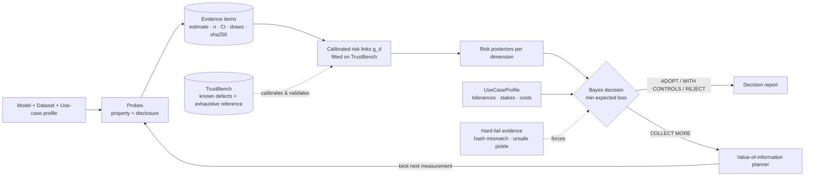

# TrustLens v2 — specification set

Status: **draft for review**. Nothing here is implemented yet. v1 (thesis build) is frozen in `archive/v1/` and in `Main` history.

Constraints fixed by the owner: one-year horizon, no external deadline, development hardware is an RTX 4060 Laptop GPU (8 GB VRAM), no LLMs anywhere in scoring or reports.

## The idea in one picture

v1 measures five dimensions, then leaves the hard step (evidence → rating) to a human. v2 makes that step a **validated, uncertainty-aware decision**, and proves it against an independent ground truth.

## What makes it more than "a dashboard of metrics"

| Typical tool | TrustLens v2 |
| ------------ | ------------ |
| Reports metrics, user interprets | Maps evidence to risk with a **link validated against ground truth** |
| One number or a table | **Decision with all four expected losses shown**, interval on every risk |
| Missing data → skipped or zero | Missing data → **explicit abstention** and a plan for what to measure next |
| Thresholds hard-coded | Thresholds come from a **declared use-case profile** and are sensitivity-tested |
| "Trustworthy" is asserted | Trust is defined **operationally** and the audit's predictive validity is measured (TrustBench) |
| Tamper checks are advisory | Verified tampering is a **non-overridable reject** (ADR 0014) |

## Documents

| # | Spec | Answers |
| - | ---- | ------- |
| 00 | [Vision and scope](00-vision-and-scope.md) | What v2 is, non-goals, measurable success |
| 01 | [v1 baseline and known issues](01-v1-baseline-and-known-issues.md) | What backend really implements, suspected bugs, bug-hunt protocol |
| 02 | [Probe redesign](02-probe-redesign.md) | New technique per dimension, evidence contract |
| 03 | [Trust decision engine](03-trust-decision-engine.md) | The algorithm: posteriors, loss profiles, Bayes action, VOI |
| 04 | [TrustBench ground truth](04-trustbench-ground-truth.md) | How trust gets a testable definition |
| 05 | [Scope expansion](05-scope-expansion.md) | Capability ladder, adapters, model sources |
| 06 | [Architecture and migration](06-architecture-and-migration.md) | Modules, API/DB, reliability, testing, hygiene |
| 07 | [Roadmap (12 months)](07-roadmap.md) | Quarter-by-quarter plan, milestones, cut lines, risks |
| 08 | [Worked example](08-worked-example.md) | One audit end to end, with numbers (illustrative) |
| 09 | [Related work and novelty](09-related-work-and-novelty.md) | Exact claim, comparison with existing tools, what is not new |
| 10 | [Compute plan (RTX 4060)](10-compute-plan.md) | GPU/time budget, what fits in 8 GB, how to stay reproducible |
| 11 | [Glossary and FAQ](11-glossary-and-faq.md) | Terms, and the questions a reviewer will ask |
| ADR | [0014 Hard-fail policy](../adr/0014-hard-fail-evidence-policy.md) | Tier A vs Tier B integrity findings |

Reading order for a newcomer: README → 00 → 08 (see it work) → 03 → 04 → 02 → 09 → 05 → 06 → 10 → 07.

## Conventions

- MUST / SHOULD / MAY follow RFC 2119.
- **Evidence** = measured statistic with uncertainty. **Risk** = latent harm-relevant quantity in [0,1]. **Rating** = human judgement. They stay separate types, the one v1 design decision kept verbatim.
- **[ASSUMPTION]** marks things to confirm before building.
- Every numeric threshold MUST be calibrated on TrustBench dev models or justified in the spec. v1's hand-set constants (confidence factors 0.45/0.55, `D = 8`) are what v2 replaces.
- No LLM in measurement, scoring, decisions or reports. Small local models may be used *as measurement instruments* (e.g. a paraphraser), versioned and hashed like any other artefact.
