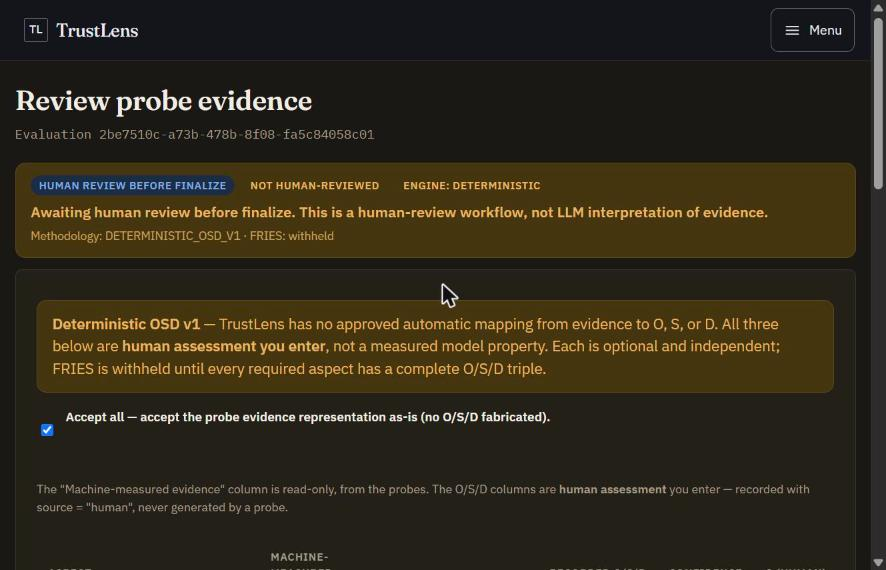
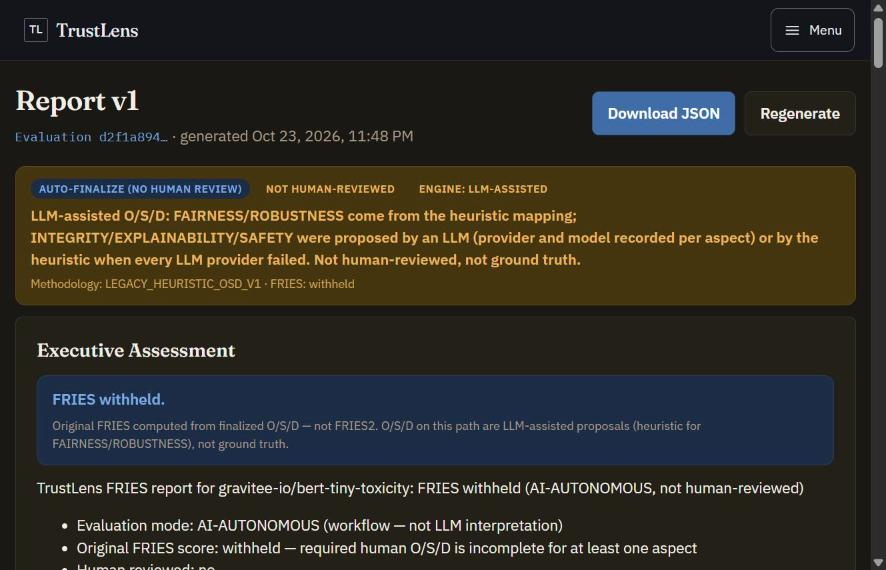

<div align="center">

# TrustLens Frontend

**The dashboard for the full audit journey, no `curl` needed.**


[Run](#run) · [Routes](#routes) · [Demo script](#demo-script) · [Known limitations](#known-limitations)

</div>

**Import HF model → create evaluation (per-dimension draft) → poll status → (Assisted: review) → report → publish / keep private.**

Plain CSS, native `fetch` and `react-router-dom`, with no UI framework. It is a single-user local app, so there is no login.

<p align="center">
  
  &nbsp;
  
</p>

## Run

```powershell
cd frontend
npm install
npm run dev        # http://localhost:5173 (backend at http://localhost:8000)
npm run build      # tsc -b + vite build
npm test           # node --test format.test.ts + vitest
```

Or use Compose: `docker compose up --build -d` starts the Vite dev server in a container.

| Setting | Value |
| ------- | ----- |
| API origin | `VITE_API_BASE_URL` (Compose sets it; default `http://localhost:8000`) |
| CORS | The backend already allows `http://localhost:5173` |

## Routes

| Path | Page |
| ---- | ---- |
| `/` | Overview: models and recent evaluations |
| `/models` | Model list (cursor pagination) |
| `/models/import` | HF import (repo id or URL, optional revision) |
| `/models/:id` | Model detail, documentation sources, start a new evaluation |
| `/evaluations` | Evaluation history |
| `/evaluations/new` | Per-dimension evaluation draft (dataset intake, column roles, confirm) |
| `/evaluations/:id` | Live status and timeline, mode disclosure, evidence dossier, O/S/D, confidence, FRIES, publish/unpublish, report link |
| `/evaluations/:id/review` | Assisted O/S/D review and finalize |
| `/reports/:evaluationId` | Latest report (auto-generates), JSON download, traceability |
| `/documentation` | Methodology notes |
| `/settings` | Local settings |
| `/gallery` | Design-system primitives gallery (outside the app layout) |

Unknown paths redirect to `/`.

## Demo script

1. **Autonomous:** import `distilbert-base-uncased-finetuned-sst-2-english`, open the model and create an **AI-Autonomous** evaluation. Watch it poll to `FINALIZED`, open the report, go back and **Publish**.
2. **Assisted:** on the same model create an **AI-Assisted** evaluation. Status parks at `AWAITING_REVIEW`. Open **Review O/S/D**, accept all or edit values, then submit and finalize. FRIES appears and the report shows *human-reviewed*.

## Placeholder data

Some screens use clearly tagged placeholder fixtures where the backend records no data yet. See [`src/mocks/README.md`](src/mocks/README.md).

## Known limitations

- Report PDF and JSON storage URIs are not browser-fetchable, so the page offers a JSON download built from the inline `report_json`.
- There is no E2E suite. The demo script above is the manual checklist.
